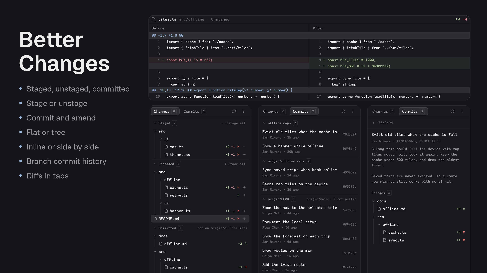
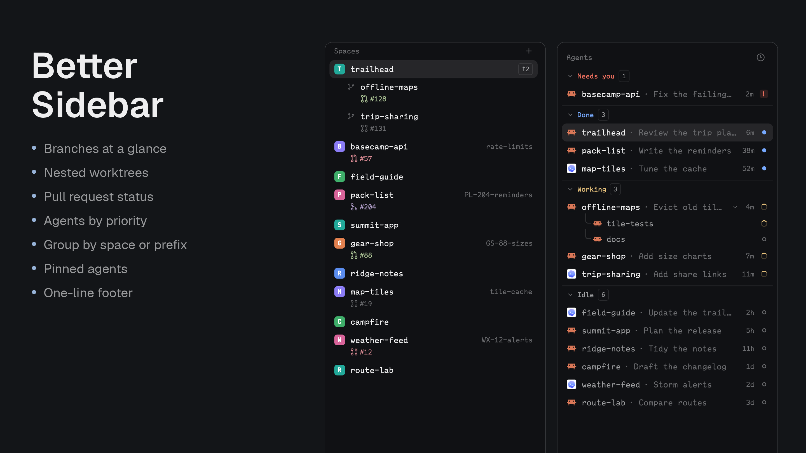
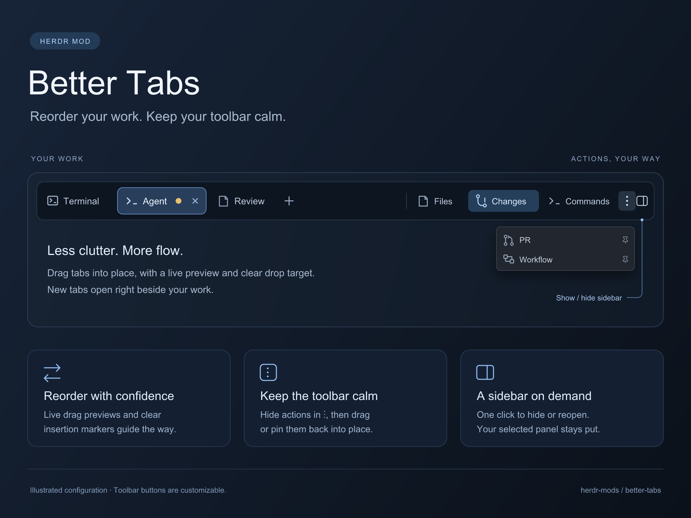
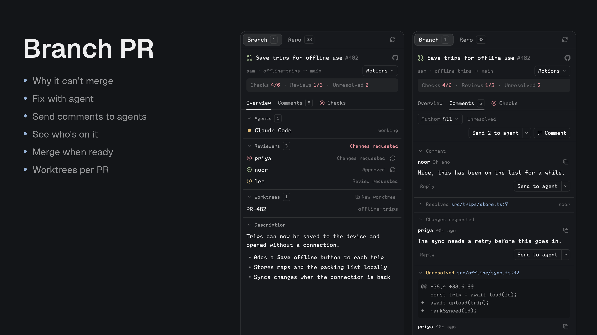
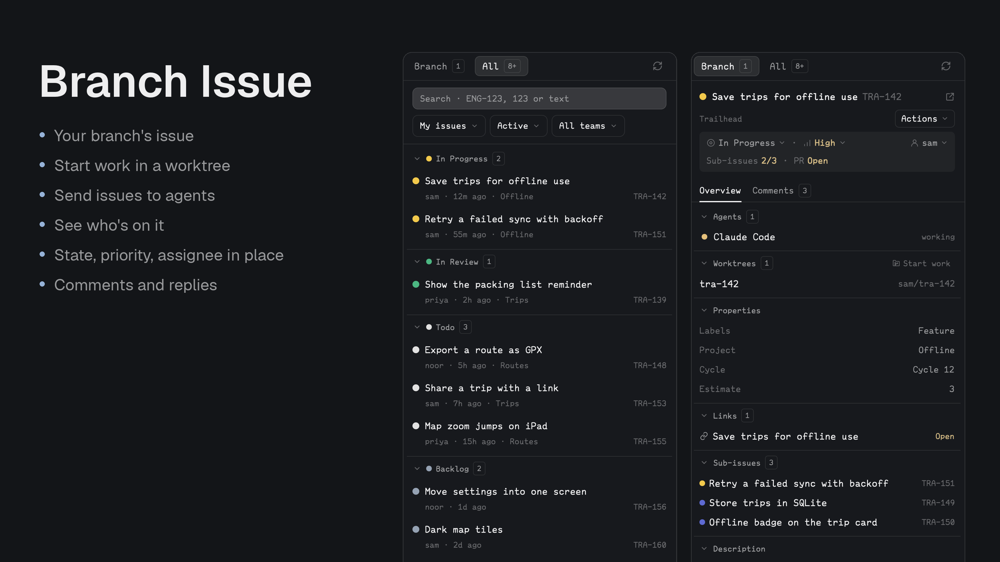
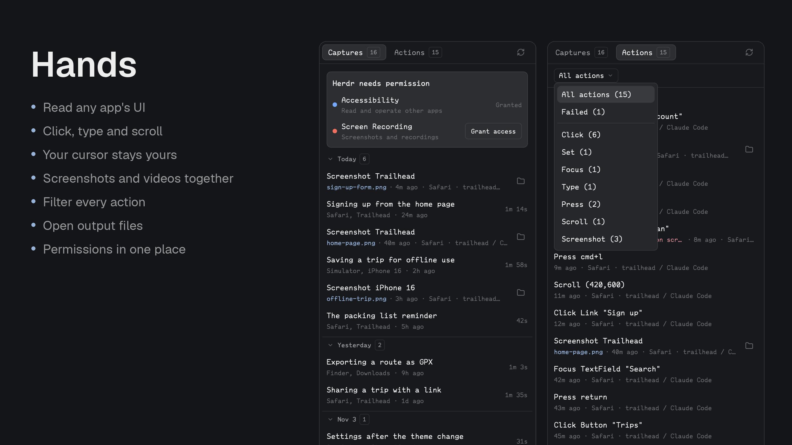

# Herdr Mods

Independent mods for [Herdr Desktop](https://herdr.dev/).

A collection of standalone mods—not a bundled workflow or replacement layout. Choose a mod below and install only that package.

## Available mods

| Mod | What it does |
| --- | --- |
| [Better Changes](better-changes/README.md) | Git panel in Herdr's own style: staged, unstaged and unpushed files, stage and unstage, commit and amend, history, and a reusable inline or side-by-side diff tab. |
| [Better Sidebar](better-sidebar/README.md) | Spaces and nested worktrees with right-aligned Git branches and color-coded pull-request status from `gh`, agents grouped by main space or name prefix, and a one-line footer. |
| [Better Tabs](better-tabs/README.md) | Tab bar with draggable tabs that wrap onto more lines, a toolbar for panels, and a ⋮ menu to hide and pin them. |
| [Branch PR](branch-pr/README.md) | GitHub PR sidebar that shows what stands between a PR and a merge, hands failures and comments to agents, and merges when ready. |
| [Branch Issue](branch-issue/README.md) | Linear issue sidebar that follows the branch, with an All tab, state, priority and assignee edits, comments, and Start work worktrees with agent handoff. |
| [hands](hands/README.md) | A `hands` CLI that gives agents hands on the Mac: read any app's accessibility tree, click, type, set values, scroll, screenshot a window, record the screen. Plus a panel with its captures, a filterable action history and its permissions. |

### Better Changes



### Better Sidebar



### Better Tabs



### Branch PR



### Branch Issue



### hands



## Quick install

Copy this template into your Herdr agent, replacing `<mod-folder>` with the folder name of the mod you want:

```text
Read ~/.config/herdr-app/AGENTS.md, then add this mod: https://github.com/munza/herdr-mods/tree/main/<mod-folder>
```

For example, to install Better Sidebar:

> Read ~/.config/herdr-app/AGENTS.md, then add this mod: https://github.com/munza/herdr-mods/tree/main/better-sidebar

Each mod's README covers its features and requirements; its `RECIPE.md` guides installation. Installing one mod does not install the others.

## Versions and settings

Every mod carries a `version` and a `settings` block in its `mods/<name>/mod.json`, which the installed copy keeps, so `cat ~/.config/herdr-app/mods/<name>/mod.json` shows what a Herdr has and what it is set to. Edit the installed file to change a setting; Herdr reloads the mod at once. Mods with a Go helper have an installer that keeps your settings and print the new and previous version on `--update`; the others are updated by copying their `mods/<name>/` folder again, after which you re-apply your edits. Each README lists its keys. Bump the version with any change that is worth updating for.

## Test

Requires Node.js and Go for development tests:

```sh
(cd better-changes && node --test tests/*.test.cjs)
(cd better-sidebar && node --test tests/*.test.cjs)
(cd better-tabs && node --test tests/*.test.cjs)
(cd branch-pr && node --test tests/*.test.cjs)
(cd branch-pr/helper && go test ./... && go vet ./...)
(cd branch-issue && node --test tests/*.test.cjs)
(cd branch-issue/helper && go test ./... && go vet ./...)
(cd hands && node --test tests/*.test.cjs)
(cd hands/helper && go test ./... && go vet ./...)
```

The mods use Herdr's native JavaScript runtime, without Node.js at runtime. Better Changes uses Git; Better Sidebar uses Git, the GitHub CLI, and Herdr's `hc`. Better Tabs uses Herdr commands and has no external executable dependency. Branch PR uses Git, `gh`, `hc`, and a bundled local Go helper (built during installation with Go 1.23+); see its README for access and explicit write actions. hands uses macOS's Accessibility and ScreenCaptureKit frameworks through a bundled Go helper and needs Herdr to be granted Accessibility and Screen Recording; see its README before installing.

## License

[Apache-2.0](LICENSE). See [NOTICE](NOTICE) for upstream attribution.
