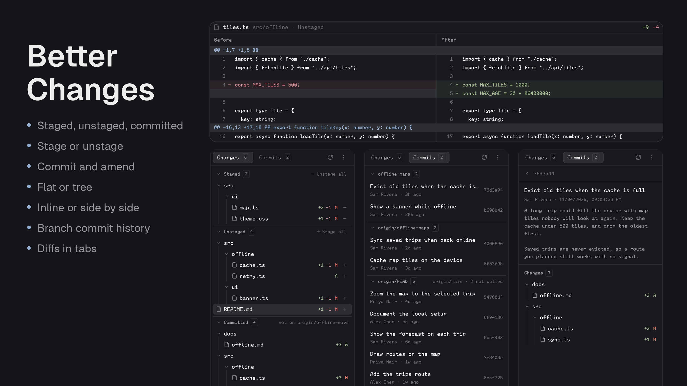

# Better Changes

A focused Git changes sidebar and diff viewer for Herdr Desktop.



- Full-height changed-file list, with connected icon pills for **Tree / Flat** and **Inline / Side by side**. Hover for tooltips.
- Separate **Staged** and **Unstaged** groups. Use **+** to stage and **−** to unstage a file, or the group-header controls for all files.
- Partially staged files appear in both groups; each entry opens its own version of the diff.
- One reusable diff tab per space. File selections rename the tab to the filename. Close it with the tab close button or your existing `tab.close` binding (normally **Cmd+W** on macOS).
- Aligned Before/After columns in side-by-side mode, with shared vertical scrolling. Trackpad horizontal scrolling, Shift+wheel, or the header arrows scroll both columns horizontally.
- Herdr's configured fonts, green additions, red removals, and old/new line numbers.
- A multiline commit-message editor and an icon-labelled **Commit / Amend** split button. Both operations use only the staged index; unstaged edits stay untouched. Unstaging also preserves working files before the first commit.
- Local and remote spaces: Git and file reads run on the space's machine.
- A **Commits** tab beside **Changes** lists history 50 commits at a time with a **Load more** row. Opening a commit shows its subject, author, date, body, and changed files; clicking a file opens that commit's diff in the same centre tab.

## Install only this mod

Copy this prompt into your Herdr agent:

> Read ~/.config/herdr-app/AGENTS.md, then add this mod: https://github.com/munza/herdr-mods/tree/main/better-changes

The package's [RECIPE.md](RECIPE.md) guides installation: read the source, copy only `mods/better-changes/` into your Herdr app configuration, validate it, and fit its sidebar into your existing layout. No bundled layout replaces your setup.

Requires a Herdr version supporting mod tabs (`tab.new { mod, props }`) and Git on each machine you use. The default manifest docks the sidebar on the right at 368px when Herdr first discovers it, but Herdr's shipped layouts (`main`, `terminals`, `win98`) are read-only and restored on every start, so the mod only shows in a layout you own. If you are on a shipped layout, your agent clones it and points its Changes slot at `better-changes` with `{ "mode": "sidebar" }`; if you already have your own layout, it asks whether to add the mod there or create a new layout.

A name clash must be resolved before copying: retain the existing mod, rename this package's folder, and update its mod names and asset prefixes consistently. Do not overwrite an unrelated installation.

## Commit and amend

Write a title and optional body in the multiline **Commit message** field. **Enter** inserts a newline; it does not commit. The main button runs the selected operation; its adjacent dropdown selects **Commit** or **Amend** without executing either one.

- **Commit** creates a new commit from staged changes and requires a nonempty message and at least one staged change.
- **Amend** rewrites the latest commit with the staged changes and your message. It can also change just the message when nothing is staged. Selecting it loads the latest commit's message into an empty editor, but never replaces an existing draft or text typed while loading. Amend is unavailable before the first commit.
- Amend shows a history-rewrite warning and rechecks the latest commit before executing. If another tool advanced `HEAD`, select **Amend** again before retrying. Be careful with commits already shared with others; this mod never pushes or force-pushes.
- Both operations are disabled while loading/busy or when conflicts remain. Failures preserve your message. A successful amend returns the button to **Commit** mode.

## Commits

The **Changes / Commits** pill in the header switches the sidebar between uncommitted changes and history. The list shows each commit's subject, author, relative age, and short hash, newest first, and loads 50 at a time. Click a commit for its full message and the files it touched, with the same Tree / Flat toggle; click **Commits** at the top to go back. When `origin` points at GitHub, Cmd-click (Ctrl-click elsewhere) the short hash to open the commit on GitHub. Clicking a file opens its diff for that commit in the reusable diff tab. Merge commits are shown against their first parent. The commit footer is hidden on this tab.

## Limits

The list displays at most 1,000 changed files. Bulk stage/unstage applies to the whole repository. Diff previews display at most 1,500 lines and 4,000 characters per line. Binary, unreadable, and empty files show explicit messages. Split view pairs adjacent removed/added lines by position; it does not calculate word-level matching. File trees do not detect renames; a rename appears as deletion/addition.

Colors indicate additions/removals, not whether an AI or human edited the lines. Git and Herdr do not supply reliable uncommitted edit-author attribution.

The sidebar reads repository status on a timer and uses local folder watches. Remote repositories refresh through polling. Explicit `source: { cwd, on }` props can pin the mod to a repository; normally it follows the active terminal.

## Settings

The installed `mods/better-changes/mod.json` has a `settings` block; copy your edits forward when you update the mod:

```json
"settings": {
  "refresh": { "status": "10s" },
  "limits": { "files": 1000, "diff_lines": 1500, "line_length": 4000, "commits_per_page": 50 },
  "default": { "view": "tree", "diff": "inline" }
}
```

`refresh.status` is the Git status poll interval. `limits` bound the file list, the lines and line length shown in a diff, and the commits loaded per page. `default.view` (`tree` or `flat`) and `default.diff` (`inline` or `split`) apply until you have chosen one, which is remembered. Problems with the block are logged, not shown.

## Development

### Code map

- `mods/better-changes/main.js` — the native Herdr view, organized into lifecycle/synchronization, repository status, file selection, diff loading, Git mutations, and rendering sections. The sidebar and diff tab are separate instances of the same view; namespaced shared state connects them.
- `mods/better-changes/model.js` — pure transformations for Git status/numstat parsing, file trees, line numbering, and side-by-side row pairing.
- `mods/better-changes/typography.js` — sizing and font helpers that follow Herdr's live settings.
- `tests/changes.test.cjs` — a lightweight Herdr/GPUI stand-in plus behavior tests, including real Git operations in temporary repositories.
- `tests/packaging.test.cjs` — standalone packaging and asset checks.

Start with `model.js` for the data shapes, then follow `init()` → `refresh()` → `render()` in `main.js`. Clicking a file calls `pick()` in the sidebar; the diff tab observes that selection through `syncSelection()` and loads its preview with `loadDiff()`. Comments explain repository pinning, async request invalidation, and index-only Git mutations.

### Checks

```sh
node --test tests/*.test.cjs
herdr-app check "$HOME/.config/herdr-app/mods/better-changes"
```

Tests cover file parsing, trees, partial staging, index-only commits and amends, multiline messages, mode selection and keyboard navigation, draft preservation, changed-HEAD guards, real Git index/history operations, stale responses, tab reuse, repository pinning, and split-line alignment. Run Git-operation tests in temporary repositories; do not stage or commit a user's working repository for testing.

See the repository's [LICENSE](../LICENSE) and [NOTICE](../NOTICE).
