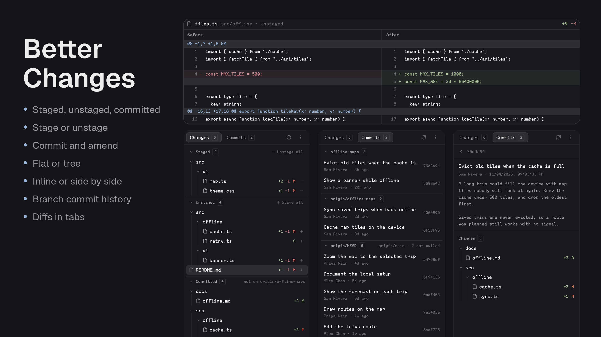

# Better Changes

A Git sidebar for the person's existing Herdr window: a full-height changed-file list with stage/unstage actions, opening files in one reusable diff tab. Switch the file list between Tree and Flat and the diff between Inline and Side by side using compact connected icon pills.

## What you see

The right sidebar starts at 368px wide. Its 44px header shows Changes, a file count, the Inline/Side-by-side pill, the Tree/Flat pill, and refresh. Each pill uses 22px icon cells, 2px padding/gaps, a 1px border in the selected colour and no group fill, tooltips, and a soft selected-colour fill on the active option; the refresh button is likewise borderless with a hover fill only, while the stage/unstage buttons keep a resting selected-colour fill. Tree rows indent 12px per level with a faint 1px guide line under each ancestor's chevron. Folders show only a chevron (down when open, right when collapsed) and their name, no folder icon.

The scrolling body fills the space above the footer. A 1px border-colour rule separates the two sections. Staged and Unstaged section headers show counts and small minus/plus bulk-action buttons. Tree folders collapse independently per section. File rows are 30px high, show a filename, status letter, available addition/removal counts, and a 20px stage or unstage action. Flat view also shows each file's directory. A partially staged file appears in both sections.

The footer has a full-width four-row multiline commit-message editor (84px high), then a 32px split button with a primary action and a 30px chevron trigger. Its compact 190px native popover has icon-labelled Commit and Amend choices in 30px rows, 5px padding, standard 12.8px menu text, theme colors, and keyboard navigation. The primary action starts as Commit staged and changes to Amend after selection. An amber warning explains that amend rewrites the latest commit. Both operations use only the index and require a message; Commit also requires staged changes, while Amend requires an existing HEAD and a loaded commit snapshot. Both are disabled while busy/loading or with unresolved conflicts. Agent status (working/blocked/done/idle) is not presented here; this mod represents Git state, not agent state.

A selected file opens a regular center tab named after the filename, retaining the original terminal and agent tabs. The diff has a full path title, counts, refresh, close, repository/scope metadata, and colored rows. Inline shows old/new line-number gutters. Split shows aligned Before/After columns with one vertical scroll position, blank padding opposite unmatched lines, fixed line-number gutters, and synchronized horizontal movement.

All colors use Herdr's theme tokens. UI font families inherit the app's settings. `em(n)` resolves relative sizes from `ui_font_size` when available, otherwise `font_size`, with 14 as fallback. Diff text uses the configured code font and base size. Additions use `ansi2`; removals use `ansi1`; hunk headings use `accent`.

## How it behaves

Click a file to view its selected staged/unstaged scope. Reuse one Better Changes mod tab per space, update its name for every file selection, and select it. Closing with the tab button, the diff close control, or the person's existing `tab.close` binding (usually Cmd+W on macOS) closes only that diff tab. A later file click creates a replacement.

The mod tab pins its source repository: a mod pane has no terminal cwd, and selecting it must not redirect the sidebar to the space's original folder or home. Keep per-space tab selections and reject stale async responses when the file or repository changes. Rapid selections while the tab is opening create one tab and keep the latest file.

Pill clicks remember the list/diff preferences. Inline/Side-by-side updates the existing tab without loading Git again or opening another tab. Hovering icons explains their actions. Split view horizontally scrolls with trackpad gestures, Shift+wheel, or its small arrow controls; vertical scrolling stays aligned.

Stage/unstage buttons stop propagation so they do not also select files. Stage one path literally, including brackets or leading dashes. Stage all uses `git add -A`. Unstage uses an index-only reset to HEAD; without HEAD, remove the path from the index using `git rm --cached`, preserving working files. Never discard/reset working files. Commit uses `git commit -m` without automatically staging. Choosing a dropdown mode never executes a commit. Enter in the message editor inserts a newline rather than submitting. Selecting Amend reads the latest commit ID and full message with `git log -1 --format=%H%x00%B`, preserving any existing draft or edits made while that read is pending. Invalidate pending reads when switching mode or repository. Before `git commit --amend -m`, recheck HEAD against that snapshot; abort with a visible message if it changed. Allow message-only amendments without staged changes. Never use `-a`, automatically push, reset authorship, or force-push. Failures release the busy state, retain the message, and display the Git error. On success return to Commit mode, and do not erase new text typed during the write.

Refresh after mutations; notify the corresponding diff tab through shared state. Poll Git every 10 seconds, check changed context every 300ms, and watch local repositories for saves. Remote Git/file operations use the space's machine. Reads disable optional locks, fsmonitor, external diff drivers, and textconv where applicable so status reads do not trigger their own watches or execute diff helpers.

## Built from

One self-contained native mod: `mods/better-changes/`, with `main.js`, `model.js`, `typography.js`, `mod.json`, and local SVG assets. No layouts directory, plugin, workflow, GitHub API helper, Node runtime dependency, or other custom mod is required.

`mod.json`: `{ "place": "right", "size": 368, "title": "Better Changes" }`. The default role is the sidebar; `{ "mode": "sidebar" }` can be placed in an existing Changes slot. `{ "mode": "diff", "space": "<space-id>", "source": { "cwd": "<repo>", "on": null }, "selection": { ... } }` is passed to a regular mod tab. Optional source props pin a sidebar for a fixed repository. Native mod tabs require a layout that displays its active tab; if an optional Factory-style center-body stack exists, reveal its main child. Do not assume that stack exists in other layouts.

Use GPUI `div`, `svg`, flex containers, `TextareaState`/`Textarea`, `Popover` with focus handles, native virtual lists and Scrollbar. Herdr supplies spaces, panes, focus, settings/theme, props, exec, readTextFile, watchFolder, shared state, localStorage, timers, command delivery, and run. Commands used include tab.new with mod/props, tab.select, tab.rename, tab.close, and conditional layout.select. The only external executable is Git. All icons live in this mod's folder. Use the `better-changes.*` shared-state namespace so this package can coexist with other Changes mods.

No new key bindings are required. Optional mod commands: `better-changes.open:<relative-path>`, `better-changes.diff-inline`, and `better-changes.diff-split`; commands reach visible copies only.

## Watch out

Read every package file before installing. Explain that it runs Git and reads the selected repository's files. Preserve the person's layout and bindings. Copy only `mods/better-changes/`, not this recipe, preview, tests, or the whole repository. If the name is taken, rename the new copy, its mod identifiers, and its asset paths consistently; never overwrite an unrelated mod.

Copying the folder is not enough to show it. Herdr's shipped layouts (`main`, `terminals`, `win98`) are read-only and restored on every start, so a mod docked into one disappears; the mod only shows in a layout the person owns. After copying, check `shared("layout")` and the person's `layouts/` folder. If the shown layout is shipped, clone it (`herdr-app do layout.clone '{"name":"main","as":"<name>"}'`, which switches to the clone) and in the clone point the Changes slot (`changes` node, `content.mod`) at `better-changes` with `{ "mode": "sidebar" }`, or add a new right panel block if there is no Changes slot. If the person already has their own layout, ask whether to add the mod to it or to create a new layout. Say which layout now holds it.

Herdr uses native GPUI, not HTML, a web view, Node, or CSS. Do not notify during render. A manifest's docking placement applies on first discovery; existing layouts determine later placement. State is isolated per mod copy, so sidebar-to-tab communication uses shared state and saved per-space selections.

Limit the list to 1,000 files, preview to 1,500 lines, and each line to 4,000 characters, with visible limit messages. Bulk index operations affect all files, including those beyond the visible list limit. Handle binaries, empty files, deletions, conflicts, no initial commit, index/working-tree differences, pathspec characters, and unavailable remote machines. A rename is intentionally displayed as delete/add. Git status does not identify whether an uncommitted line was written by an agent or the person; never infer author colors from agent activity.

Split replacements are paired positionally inside each contiguous block, without crossing hunk or context boundaries. Use a single virtual list to keep vertical scrolling aligned. Clip long text inside equal-width cells and move both text viewports horizontally while retaining gutters.

## Done when

- `node --test tests/*.test.cjs` passes from this package folder, including real Git tests in temporary repositories.
- `herdr-app check <installed-mod-folder>` passes; live renders of sidebar, Inline, and Side by side have no mod errors.
- Tree and Flat show the same changed files; collapsing a folder affects only its section.
- Plus/minus file controls update the correct index path without selecting the file; bulk buttons act on all files.
- A partially staged file has distinct staged and unstaged previews. Commit staged leaves unstaged working edits intact; unstage before the first commit preserves working files.
- The commit message supports title/body newlines; Enter does not submit. Dropdown mode selection and keyboard navigation never commit by themselves.
- Amend preloads an empty editor without replacing drafts, permits a message-only amendment, rejects changed HEAD or missing history, preserves parent/count and unstaged edits in temporary-repository tests, and retains the draft on failure.
- Repeated file clicks reuse one tab per space, rename it correctly, preserve the repository, close through tab.close, and recreate after closing.
- Both diff layouts show correct old/new line numbers; uneven replacements and multiple hunks align without losing lines.
- The mod installs independently into the person's existing layout and has no dependency on other custom mods.
