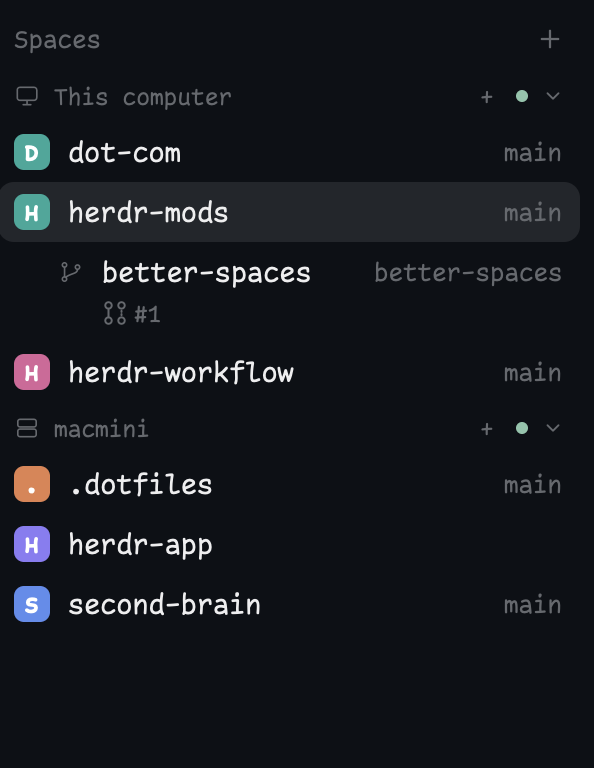

# Better Spaces

A standalone spaces sidebar for Herdr Desktop: right-aligned Git branches, nested worktrees, and color-coded pull-request status from the GitHub CLI.



The screenshot shows a nested worktree with its branch aligned right and a gray draft PR badge beneath it. Cmd-click the PR number to open it on GitHub.

- The current branch stays on the **same row as the space name, aligned right**, including `main`, `master`, and branches already used as the space's name.
- Worktree spaces nest beneath an open space for the same repository. Each worktree keeps its own branch and PR status.
- A PR line below the space/worktree shows an icon and number: **green Open**, **gray Draft**, **purple Merged**, **red Closed**, or **red Checks failed**. Drafts omit the visible status label; their icon, color, and tooltip convey the state. Colors follow the current theme.
- **Cmd-click the PR number** to open its GitHub URL (Ctrl-click on Linux/Windows). A normal click still selects the space. Hover a PR for its repository, title, and status. If there are several open PRs, the newest is shown with a `+N` summary; hover that summary for the others.
- Preserves space selection, right-click menus, drag reordering within a machine, colored avatars, ahead/behind counts, machine groups, and the compact sidebar rail.

## Install

Copy this prompt into your Herdr agent:

> Read ~/.config/herdr-app/AGENTS.md, then add this mod: https://github.com/munza/herdr-mods/tree/main/better-spaces

Installation follows [RECIPE.md](RECIPE.md). Copy only `mods/better-spaces/` into the app configuration. The manifest uses `"place": "none"`: the installer should **replace the existing spaces block's mod reference**, not add a second sidebar. Herdr's shipped layouts (`main`, `terminals`, `win98`) are read-only and restored on every start, so the mod only shows in a layout you own. If you are on a shipped layout, your agent clones it and edits the clone; if you already have your own layout, it asks whether to add the mod there or create a new layout. Preserve the agents list, other panels, key bindings, and the existing layout's dimensions. Never overwrite an unrelated mod on a name clash.

The spaces block should reference `"mod": "better-spaces"`. Keep its existing ID, size, and other properties. Leave the previous mod installed if other layouts still use it; restoring that reference rolls back the change.

## Requirements and access

- Git on every machine whose spaces you use.
- A local installation of [GitHub CLI](https://cli.github.com/), authenticated with `gh auth login`, with access to the repositories you want to show.
- Herdr's native mod APIs; no Node.js runtime dependency.

The mod runs read-only Git commands in space directories and calls `gh pr list` / `gh pr view`, which contact GitHub using your local credentials. **Remote Git reads run on the space's machine; GitHub queries run locally.** It never stages, commits, checks out branches, creates PRs, or changes Git configuration.

A space's branch and PR describe its **first terminal's live directory**, falling back to the space's folder—matching Herdr's space naming and worktree grouping. Switching to a different terminal tab does not change that rule.

## PR discovery and limits

GitHub.com HTTPS and SSH remotes are supported. GitLab, other hosts, and GitHub Enterprise hosts are not currently supported. Detached HEADs, non-Git folders, and branches with no matching PR have no PR line.

The mod checks the current branch against the checkout's GitHub remotes. It ignores same-named branches from unrelated forks, prefers open PRs, and otherwise shows the most recently updated closed/merged PR. Discovery examines at most 100 PRs per repository and branch.

An existing `branch.<branch>.herdr-pr` Git setting such as `owner/repo#42` overrides automatic discovery. The mod only reads that setting; it does not create it.

PR results refresh at most once a minute per checkout, with immediate lookups when Herdr reports a branch change. Successful identical GitHub queries are cached for one minute. Local Git changes also trigger refreshes through Git-directory watches; remote/external changes have a 15-second foreground fallback. An API or authentication failure preserves last-good PRs **only for the same branch**, marks them stale, and exposes the error on hover. Without a previous result, the line reads `PR unavailable`. New branch selections never inherit an old branch's PR.

The PR badge has no merge or review controls. Selecting its row selects the space; Cmd-clicking the number opens the PR in your default browser. Space menus continue to use Herdr's shipped `menu` mod. Worktree grouping is for **open spaces**, not every checkout on disk. A worktree without an open main-checkout space remains a top-level row.

## Development

- `mods/better-spaces/main.js` — space navigation, Git metadata, worktree/machine grouping, and native rendering.
- `mods/better-spaces/pr-status.js` — GitHub discovery, PR appearance, caching, and stale-response protection.
- `mods/better-spaces/typography.js` — sizing from Herdr's live font settings.
- `tests/spaces.test.cjs` — isolated Herdr/GPUI stand-ins for discovery, polling, races, grouping, rendering, and packaging.

```sh
node --test tests/*.test.cjs
herdr-app check "$PWD/mods/better-spaces"
```

See the repository's [LICENSE](../LICENSE) and [NOTICE](../NOTICE) for upstream attribution.
