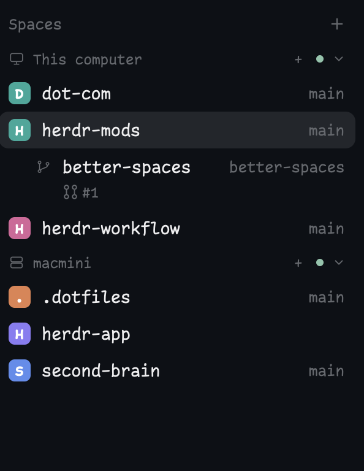

# Better Spaces

A replacement spaces sidebar for a person's existing Herdr layout. Space names and their current Git branches share one line, with branches aligned right. Worktree spaces nest under their repository's main-checkout space. A second line shows the checkout's pull request with a state-specific icon, number, and color, queried through the local GitHub CLI.

## What you see

A full-height theme-chrome sidebar with a 31px header labeled Spaces and a plus button. The body scrolls vertically. Main space rows are 30px high; nested worktrees are 28px. A row with PR status gets 22px extra height. Active rows use the theme's selected background; other rows highlight on hover.

Main rows have an 18px rounded colored initial avatar, a truncating space name, then a flexible right-aligned branch tail at 90% of the UI font size. Always show the branch, even main/master or a duplicate of the name. Show detached for detached HEAD. Ahead counts use green and behind counts red. Worktrees indent 22px with a branch icon instead of an avatar. Keep names and branches on the same line and make long text truncate rather than widening the sidebar.

PR lines indent beneath the name: 27px for main rows, 44px for worktrees. Show the newest matching open PR as `#42 · Open` with its local SVG icon. Open is theme ansi2 green; draft is dim gray with a draft icon; merged is ansi5 purple with a merged icon; closed is ansi1 red with a closed icon. Failed/error/timed-out/action-required/startup-failure checks color an open non-draft PR red and label it Checks failed. Omit the visible Draft label: show only its icon and linked number, keeping Draft in the tooltip. Other statuses keep their labels. Terminal PR states take precedence over draft/check flags. A +N summary represents additional open matches. Tooltips identify repository, number, title, and state.

When other machines are known, add a 26px machine header with a monitor/server icon, connection indication, fold control, and new-space button. A mod narrower than 160px becomes a compact rail of space numbers and a PR icon, or the existing attention glyph when no PR exists. Use the element's actual size, not an assumed layout node name.

## How it behaves

Click a row to select its space. Cmd-click the PR number on macOS (Ctrl-click on Linux/Windows) to open its GitHub URL in the default browser using the event context's open_url. Plain clicks on the number still select the space. Stop propagation of modified mouse-down, mouse-up, and click events so the enclosing row neither starts a drag nor changes selection when opening a link. Right-click opens Herdr's shipped space menu. Drag rows to reorder within a machine, never across machines. Plus creates a space; machine plus creates one there. Store folded machine state locally. Share only the existing `space.colors` avatar preferences with Herdr's menus. Do not write shared state from render.

Use the first terminal's live cwd for each space, falling back to its stored folder. Resolve the Git common directory to associate worktree spaces with an open main-checkout space on the same machine; an orphan worktree remains top-level. Newly appearing spaces wait briefly for metadata to avoid jumping between positions.

Read Git status without optional locks or fsmonitor. Watch local Git directories and refresh after terminal/agent work finishes or a remote machine reconnects; poll foreground metadata on a 15-second fallback. Detect branch changes from live pane facts. Never alter the repository.

For PR status, read the symbolic branch and any explicit `branch.<branch>.herdr-pr` association. If present, query that repository/number. Otherwise read GitHub.com remotes and query up to 100 PRs per repository for the branch. Match the exact head branch and reject unrelated fork heads. Deduplicate matches, prefer current open PRs, otherwise choose the latest updated historical one. Show nothing for detached, non-Git, unsupported-host, or no-match cases.

Poll PRs no more than once per minute per checkout unless the observed branch changes. Cache identical successful gh queries for a minute. Deduplicate checkout paths including machine identity. Ignore late responses after a branch switch or checkout removal. Retain last-good status on a network/authentication error only for the same branch and mark it stale; otherwise show PR unavailable. Explain failures in tooltips. Do not spawn jobs or notify on every fast context tick when nothing is due.

Agent states are not PR states: working/blocked/done/idle do not change the PR's color. Keep the existing compact attention glyph behavior, with blocked/done drawing a dot. The regular agents list remains a separate mod.

## Built from

One runtime folder, `mods/better-spaces/`: `main.js`, `pr-status.js`, `typography.js`, `mod.json`, and its own SVG assets. No layouts folder, key snippet, helper binary, or other custom mod is required. Manifest: `{ "place": "none", "title": "Better Spaces" }`.

Use GPUI div/svg and gpui-base vertical/horizontal flex containers. Herdr supplies spaces, panes, machines, theme, settings, exec, hc, watchFolder, window, layout, shared/setShared, localStorage, run, openOverlay, timers, and size-change callbacks. Commands are space.new, space.select, and space.move. Open the shipped menu as a popup with `{tab: "space", target: {id}}`.

Git commands run with `{cwd: folder, on: space.machine}`. GitHub CLI commands run locally with explicit `--repo owner/repo`: `gh pr list --head <branch> --state all --limit 100 --json ...` and `gh pr view <number> --json ...`. Read number, title, state, draft flag, head repository/branch, update time, ID, URL, and check rollup. Existing GitHub CLI authentication supplies access. The only external executables are Git, gh, and Herdr's hc for machine discovery; no Python or Node is used at runtime.

## Watch out

Read every package file before installation. Explain that it runs programs, reads repository metadata, and reaches GitHub with local gh credentials. Copy only the runtime folder. If its name is taken, rename the new copy and all its asset paths consistently; never overwrite an unrelated mod.

Replace only the existing spaces block's mod reference in the person's layout, preserving its ID, dimensions, sibling agents list, other panels, and key bindings. Herdr's shipped layouts (`main`, `terminals`, `win98`) are read-only and restored on every start, so edits to them are lost; the mod only shows in a layout the person owns. Check `shared("layout")`: if the shown layout is shipped, clone it with `herdr-app do layout.clone '{"name":"<shown>","as":"<name>"}'` (which switches to the clone) and edit the clone; if the person already has their own layout, ask whether to add the mod to it or to create a new layout. Say which layout now holds it. Set that block's mod reference to better-spaces. Keep the previous mod installed while other layouts still use it. Since place is none, copying the folder alone does not make it appear.

Herdr is native GPUI, not HTML/Node/CSS. Do not retain callback contexts, notify during render, or use timers for animation. Missing gh or authentication is a status error, not a reason to break space navigation. GitHub Enterprise and non-GitHub hosts are unsupported. A minute-old result is not real-time CI. Same-named fork branches must not be mistaken for the checkout. The badge links to GitHub, but is not a PR browser or merge control.

## Done when

- All tests pass and herdr-app check succeeds for the runtime folder.
- Live rendering shows right-aligned branches on the same name row for spaces and worktrees, including main/master.
- Worktrees nest under the correct checkout, without grouping identical paths across machines.
- Open, draft, merged, closed, and failing-check PR rows have the described icons/colors in populated native renders.
- Git reads use the space machine while gh uses the local login and explicit repository.
- Missing gh/authentication, no repository, detached HEAD, and no PR leave navigation usable.
- Cached reads do not cause redraw loops; branch switches/removal discard stale responses.
- Cmd-clicking a PR number opens its URL without selecting/dragging the row; ordinary clicks still select the space. Draft rows omit their text label but retain their icon, color, and tooltip.
- Clicking, space menus, same-machine drag reorder, folded machines, and the compact rail still work.
- Installation replaces only the spaces block and leaves the person's existing workflow and bindings intact.
