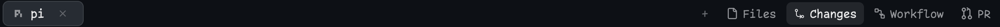

# Better Tabs

A standalone native tab bar and extensible action toolbar for [Herdr Desktop](https://herdr.dev/).



- Select, drag-reorder, double-click rename, right-click, and close tabs.
- Program icons, native working spinners, and blocked/done indicators.
- Configurable buttons for panels, app/mod commands, overlays, stack toggles, shared state, or custom local JavaScript hooks.
- Button groups, ordering, tooltips, icon-only display, shared-state badges, visibility/enabled predicates, and active highlighting.
- Responsive overflow menu, with a configurable maximum number of visible toolbar buttons.
- Optional panel memory per space; window controls where the OS requires them.
- No dependency on a workflow, Better Spaces, Better Changes, or any other custom mod.

## Install

> Read ~/.config/herdr-app/AGENTS.md, then add this mod: https://github.com/munza/herdr-mods/tree/main/better-tabs

Follow [RECIPE.md](RECIPE.md). Copy only `mods/better-tabs/` to the app's mods folder. It uses `place: none`: replace your existing tabs block's mod reference, preserving the block's dimensions and window-drag setting. Clone shipped layouts first. Do not add a second tab bar or overwrite an unrelated mod on a name clash.

The mod itself does not run executables, read repository files, or contact a network. It runs Herdr commands, opens overlays, and reads/writes mod preferences and shared state. Configured commands, overlays, and trusted hooks can perform broader operations; review them before installing.

## Configure in your layout

The tabs block's `content.props` controls the toolbar. Without custom buttons it offers Files and Changes when those layout nodes exist. Custom `buttons` **replace**, rather than append to, the defaults.

```json
{
  "mod": "better-tabs",
  "props": {
    "rememberPanels": { "container": "panel", "stack": "panel-body" },
    "buttons": [
      {
        "id": "changes",
        "label": "Changes",
        "icon": "changes",
        "group": "panels",
        "action": {
          "type": "panel",
          "container": "panel",
          "stack": "panel-body",
          "target": "changes"
        }
      },
      {
        "id": "palette",
        "label": "Commands",
        "group": "tools",
        "action": { "type": "command", "name": "app.palette" }
      }
    ],
    "commands": {
      "toggle-browser": {
        "type": "toggle-stack",
        "stack": "center-body",
        "child": "browser",
        "fallback": "main"
      }
    }
  }
}
```

Panel targets are **layout node IDs**, not mod names. A `changes` node can contain stock Changes or Better Changes. Panel actions select the target and show its container, or hide it when already selected. `rememberPanels: false` disables panel memory. Only one container/stack pair is remembered per toolbar copy.

### Actions

| Type | Fields | Behavior |
| --- | --- | --- |
| `command` | `name`, optional `args` | Dispatch a built-in or shown mod's command. |
| `panel` | `container`, `stack`, `target` | Toggle a panel and infer its active state. |
| `toggle-stack` | `stack`, `child`, `fallback` | Toggle between two children; infer active state. |
| `overlay` | `mod`, optional `kind`, `props`, `width`, `height` | Open a popup (default), dialog, or window. |
| `sequence` | `actions` | Dispatch a bounded list of actions in order; **does not wait for asynchronous completion**. |
| `shared` | `key`, `value`, or `toggle: true` | Set or toggle a shared state value. |
| `hook` | `name`, optional `args` | Call a trusted handler exported by this mod's `hooks.js`. |

`herdr-app do better-tabs.button:changes` invokes a visible configured button by ID, respecting visibility/enabled conditions. `herdr-app do better-tabs.toggle-browser` invokes the example command alias above. `herdr-app do better-tabs.overflow` opens a menu of all currently available actions. Bind those same command strings in `keys.json`; the package installs no bindings itself.

Herdr delivers mod commands only to **shown copies**. Do not use a command hook to depend on a hidden or unmounted mod. A sequence dispatches in order but is not a transaction and does not roll back earlier commands on error.

### Button presentation

- Required: unique `id`, `action`. `label` defaults to the ID.
- `icon`: bundled name (`file`, `changes`, `close`, `spinner`), or SVG path relative to the Herdr app home, e.g. `mods/my-panel/icon.svg`.
- `tooltip`, `iconOnly`, `group` (a separator when the group changes), numeric `order` (ascending, stable ties).
- `overflow: true` always puts an entry in the overflow menu.
- `disabled: true` or `enabledWhen` prevents action dispatch.
- `when` controls visibility. `activeWhen` overrides inferred active state.
- A condition is `{ "shared": "my-mod.ready" }`, `{ "shared": "my-mod.mode", "equals": "review" }`, `{ "node": "panel" }` (exists and not hidden), or `{ "node": "stack", "child": "review" }`.
- `badge`: a literal value or `{ "shared": "my-mod.count" }`. Missing/null/false/empty-string badges are omitted; zero is shown.

### Tab and toolbar preferences

`maxButtons` limits visible buttons; the responsive width budget may show fewer. Remaining buttons go to overflow. The menu snapshots its entries when opened, while badge values and active/enabled predicates remain live.

`tabMaxWidth` defaults to 170 logical px. `closeButtons` accepts `"active"` (default), `"all"`, or `"none"`. Set `programIcons`, `statusIndicators`, `newButton`, or `scrollNavigation` to false to disable them. `sidebar` overrides the sidebar node ID used for macOS traffic-light spacing. Keep layout titlebar and traffic-light settings intact.

### Other mods contributing buttons

Opt in with `"contributions": true`. A cooperating mod can publish declarative entries through Herdr shared state:

```js
const registry = shared("better-tabs.buttons") ?? {};
setShared("better-tabs.buttons", {
  ...registry,
  "my-panel": [{
    id: "my-panel.refresh",
    label: "Refresh panel",
    action: { type: "command", name: "my-panel.refresh" }
  }]
});
```

Publish on initialization or explicit state changes, **never during render**. Namespace IDs, merge without dropping other publishers, and remove your registry key when unregistering. Shared state persists across restarts; this is not automatic plugin discovery or a liveness registry. Contributions are opt-in, trusted, and can invoke any supported action. Layout-owned entries win ID clashes; owners are sorted for deterministic ordering. Shared state cannot carry callback functions.

### Custom JavaScript hook

Edit this package's `hooks.js` (a local trusted extension point):

```js
import { run } from "herdr";
export const hooks = {
  newNamedTab(args, { space }) {
    if (space) run("tab.new", { space: space.id, name: args.name });
  }
};
```

Configure `{ "type": "hook", "name": "newNamedTab", "args": { "name": "Review" } }`. Handlers receive `(args, { space, tab, cx })`; use `cx.spawn(async cx => ...)` for async work, never retain callback contexts, and never import another mod's source. Reinstalling upstream files can overwrite local hook edits; retain them separately. Exceptions and returned promise rejections become notifications.

## Development

```sh
node --test tests/*.test.cjs
herdr-app check "$PWD/mods/better-tabs"
```

`main.js` renders the tabs/toolbar and synchronizes panel memory outside render. `actions.js` resolves conditions, contributions, and declarative actions. `hooks.js` is the optional local extension point. Assets are bundled, with shipped Herdr `menu` and `new-menu` used for native menus.

Tests cover action dispatch, missing targets, recursion limits, hooks, contributions, command aliases, per-space memory, tab actions, overflow, and standalone packaging. Native checks do not replace testing deferred menu rendering in the running app.

See [LICENSE](../LICENSE) and [NOTICE](../NOTICE) for attribution.
