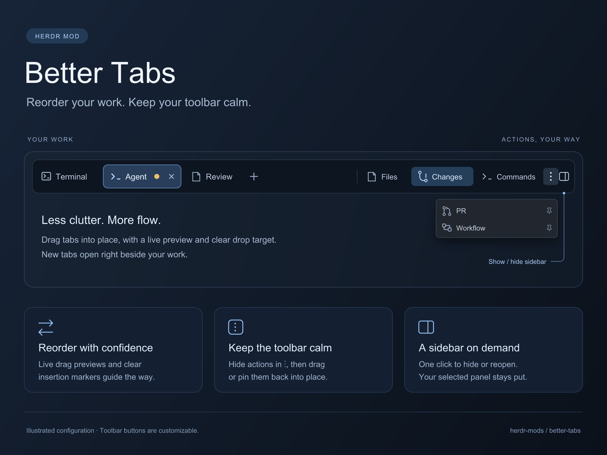

# Better Tabs

A native tab bar with a configurable action toolbar. Keep the person's existing layout and terminal tabs, and replace only the tab-bar mod. Buttons can toggle panels, run app/mod commands, open overlays, toggle stack views, update shared state, or invoke trusted JavaScript hooks local to the mod.

## What you see

A full-width theme-chrome bar, normally in a 42px-high layout block. Tabs scroll horizontally on the left. Each is 29px high, rounded 7px, with a program icon, truncating name (170px maximum by default), status indicator, and a 26px close control on the active tab. The active tab has a raised background and theme border; other tabs use muted text. Working agents get a native spinning icon, blocked/done agents a colored dot, idle tabs no attention marker.

A plus button immediately after the last tab opens Herdr's shipped new-menu; it belongs to the scrolling tab content, not the far edge of the flexible tab area. On the right, configured toolbar buttons are 26px high, with 14px icons, labels, optional badges, active highlights, hover backgrounds, and tooltips. Group changes add separators. An always-visible vertical-dots SVG (⋮) is the overflow menu and a highlighted drop-to-hide target. Overflow entries appear alphabetically in a compact 240px-wide native popup of 32px rows, each with a subtle Show in toolbar pin icon. Match Herdr's shipped menus: popover background, 12.8px text, 5px padding, no instructional heading, and a single muted No hidden actions row when empty. Anchor below and right-align with the dots button; long menus scroll within a 420px height cap. Explicit initial overflow flags, saved user choices, and the responsive width budget keep tabs from being crowded out. Windows/Linux get window controls where window().buttons requests them. macOS respects traffic-light spacing from the layout.

Fonts inherit Herdr settings; em-like values use ui_font_size, then font_size, then 14. Colors use theme tokens. No fixed dark-only palette.

## How it behaves

Click selects a tab. After a 5px movement threshold, dragging dims the source slot and shows a floating preview following the pointer, offset so it does not cover drop hitboxes. A theme-accent insertion line marks before/after placement. Commit the one-based tab.move only on release; resolve by stable tab IDs and ignore removed tabs or changed spaces. Leaving the bar cancels the drag. Do not activate another tab or the plus button as a side effect of dropping. Double-click renames; right-click opens the shipped tab menu. The active close control closes only that tab. Vertical wheel movement over the tab list navigates previous/next tabs unless disabled. Preserve named tabs and allow horizontal scrolling.

Drag a toolbar action onto the ellipsis and release to hide it without activating it. Clicking the ellipsis lists hidden and responsive-overflow actions alphabetically; selecting an entry runs its normal action. Drag an entry out of the menu to close the popup and expose the real toolbar as a drop surface; insert it before/after a visible action. The Show in toolbar control restores an entry at the front without activating it. Visible actions can also be reordered by dragging. Store hidden, pinned, and ordered stable action IDs in shared better-tabs.toolbar preferences keyed by layout and toolbarId (default main). Overflow copies receive their originating toolbar scope and full action list. Restoring an action can displace another into overflow under the width/maxButtons limit. Menu drags use short-lived shared state; clear it on drop/cancel and expire abandoned gestures. Suppress click activation after a drag.

A panel-right icon immediately after the vertical dots toggles sidebar visibility without changing the selected panel. It is not hideable with the other actions. Resolve its target from props.panelToggle, else rememberPanels.container, else panel; false disables it and missing targets omit it. Use Show sidebar / Hide sidebar tooltips and reflect visibility in icon color.

The default toolbar offers Files/Changes only when the corresponding nodes exist. Supplied props.buttons replace defaults. Each button has an ID, label, icon, action, and optional group/order, tooltip, iconOnly, badge, visibility/enabled/active conditions, disabled flag, and an initial overflow flag that the user's saved arrangement can override. Badge values may come from shared state; zero remains visible.

Actions: command(name,args), panel(container,stack,target), mod-tab(mod,name,props), toggle-stack(stack,child,fallback), overlay(mod,kind,props,width,height), sequence(actions), shared(key,value/toggle), and hook(name,args). mod-tab opens/selects one reusable mod tab per mod per space and captures props.space and props.source {cwd,on} from the focused terminal, falling back to the space folder. A short shared pending guard prevents duplicate rapid opens; the target mod uses the supplied context to pin its repository. Normal tab controls close it; later opens recreate it. Validate panel/stack targets before dispatch. Sequence nesting is bounded and dispatch order is preserved, but Herdr commands are queued: sequences do not await completion or roll back earlier actions. Hooks are explicit functions in hooks.js; no eval or arbitrary source loading. Report exceptions and returned promise rejections with notifications.

Panel buttons select/show their child or hide an already-active panel. rememberPanels selects a configurable container/stack pair; save its choice locally per space and restore on space changes with a short acknowledgement window. Run synchronization on initialization and a 300ms timer, never in render. A new copy starts from the current layout if there is no saved choice. Unknown saved children become closed panels. Corrupt saved preferences must not break the bar.

better-tabs.button:<id> invokes an eligible configured button. props.commands maps arbitrary command names to actions, so a layout can define toggle-prs without embedding PR concepts in this mod. better-tabs.overflow opens the hidden/overflow actions menu. Mod command delivery follows Herdr's shown-copy limitation. No key bindings are installed by default.

Opt-in props.contributions reads shared("better-tabs.buttons"), a map from publisher IDs to button arrays. Merge deterministic publisher order, keep layout entries on duplicate IDs, apply conditions and numeric ordering. Publishers explicitly unregister; shared state persists across restarts. It is a trusted declarative registry, not automatic plugin discovery. Popup entries snapshot when opened; badges and enabled/active conditions remain live.

## Built from

One runtime folder mods/better-tabs with main.js, actions.js, toolbar.js, hooks.js, typography.js, mod.json, and bundled SVG icons. Manifest place is none. The root README in this package documents the complete props schema and examples. No custom mod, Git executable, gh, Node runtime, workflow, or external helper is required.

Use GPUI div/svg/image and gpui-base h_flex/v_flex. Herdr APIs: spaces, panes, run, openOverlay/closeOverlay, theme, window, layout, settings, props, shared/setShared, notify, nextCommand, timers, and size-change callbacks. localStorage holds panel preferences; persistent shared state holds toolbar arrangements. toolbar.js provides pure arrangement and insertion-boundary helpers. Pointer events drive drag previews and markers, without redraw timers. The shipped menu and new-menu provide context/new-tab menus. All toolbar-owned icons are bundled; configured custom paths may refer to the target mod's icon.

The tabs block receives configuration through content.props. For a workflow layout, configure its own Workflow/PR panel actions and browser mod-tab action there. The standalone runtime contains no Factory/Workflow/PR-specific logic. Copy only this runtime folder to install, not tests, recipe, or preview. Rename consistently on an unrelated name clash, including self-opening overflow mod names and asset paths.

## Watch out

Explain access before installing: the default runtime does not execute programs, read repo files, or reach the network, but commands/overlays and custom hooks can do so. These are trusted actions, not a sandbox. Custom hooks must not import other mods' source at runtime.

Clone shipped layouts before changing structure; preserve the original tabs block ID, height, window_drag setting, and other layout nodes. place:none means copying alone does not display the mod. Panels use node IDs, not mod names. A layout may use a changes node containing Better Changes without this package depending on it.

No callback contexts retained. No side effects from render. Animation uses spin(), not timers. Native initial checks do not exercise overflow/deferred elements. Give the overflow popup an explicit width and height, with an inner flexing scroll list; putting overflow scrolling on an intrinsically sized popup root collapses it and hides the actions. Shared contributed commands cannot reach hidden mod copies. Panel memory is local to this mod copy and one configured container/stack pair. A layout switch creates a fresh toolbar instance.

## Done when

- node --test tests/*.test.cjs and herdr-app check pass.
- The running app renders tabs, icons, status, and toolbar without errors; inspect a saved screenshot.
- The plus button sits directly after the final tab. Dragging tabs shows a moving preview and correct insertion boundary in both directions, and only commits on release. Small movements remain clicks; leaving the bar cancels.
- Tab selection, reorder, rename, close, and context menus remain functional.
- Default configuration has no custom-mod dependency.
- Configured panel and stack actions use only the supplied node IDs.
- Per-space panel memory restores outside render and corrupt preferences are harmless.
- Named commands and button-ID commands dispatch eligible actions; missing targets notify instead of breaking rendering.
- The always-visible vertical dots accept drop-to-hide, open a compact anchored menu, list hidden actions alphabetically, dispatch a chosen action, and support drag-out or explicit pin restoration.
- The adjacent sidebar icon toggles the configured panel container, preserves its selected child, and supports missing/disabled/custom targets.
- Toolbar arrangement survives restart and remains isolated by layout/toolbar ID; dropped actions never accidentally activate.
- Contributions opt in explicitly, preserve layout precedence, and document persistent registry cleanup.
- Keys and unrelated layouts/mods are not overwritten; migrate only explicitly owned legacy bindings.
