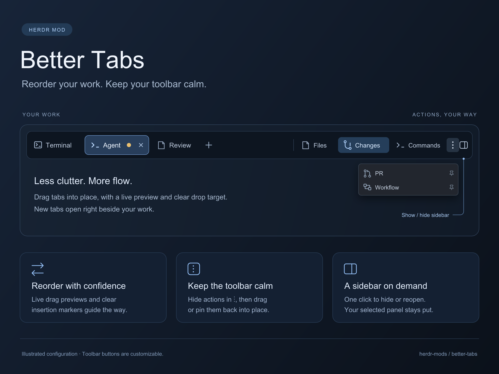

# Better Tabs

A tab bar for a person's existing Herdr layout: draggable tabs that wrap onto more lines, a + after the last tab, and a toolbar of panel buttons with a ⋮ menu to hide them in.

## What you see

A theme-chrome bar 42px high, growing as tabs wrap, with a 1px bottom `border`. Tabs and toolbar start 6.5px from the top. Tabs are 29px pills with radius 7, 10px padding, a 7px gap inside and 6px between, in 12.8px text. The active tab is `raised` with a `border` edge and a ×; others are plain in `muted`. A tab shows its program's icon at 14px, its name up to 170px, a 12px spinning `working` icon, or a 6px `blocked` or `done` dot.

After the last tab, wrapping with the tabs, is a 26px + button. On the right, staying on the first line, are the toolbar buttons, 26px high with radius 6, 12px text and an optional 14px icon, `selected` when active, with a 1px separator where the group changes. Last is a 26px ⋮ button.

While dragging, the source tab dims to 35%, a copy follows the pointer, and a 2px `accent` line sits in the gap beside the target, 4px outside its edge, clear of any tab border.

The ⋮ menu is a 240px popup on `popover` with 5px padding and 32px rows, listing hidden buttons alphabetically, each with a 22px pin button.

## How it behaves

A press becomes a drag only after 400ms and 12px of movement, for tabs and toolbar buttons alike; anything less is a click. Nothing moves until release. Leaving the bar cancels a drag. Dropping a tab on + puts it last. A tab's click selects it, double-click renames it through `tab.rename`, and right-click opens the shipped `menu` mod. `tab.move` takes a one-based index.

Tabs name themselves through `tab.rename`, from the bar's 300ms timer, never render, and not before the installed settings are read. From its panes, an agent beats another program, which beats a shell, and the first pane breaks a tie: an agent takes its `title` as Herdr gives it (its topic), on one line, with any status glyph in front removed (✳, a braille spinner) so the name holds still while it works, or its `program.name` while the title is empty or only says where it is (the folder, its path, or a short mark and the folder such as `π - lantern`); another program its `program.name`; a shell its folder (the last part, `~` for `home()`, `/` at the root). Names are cut at 80 characters. A mod's pane has no program and names nothing. A tab is renamed only when that name changes, so it follows a shell that starts an agent, then the agent's topic. `shared("better-tabs.names")` keeps, per tab, the name this mod set (`auto`) or `manual`, plus `pending` and `at` while a rename is on its way, so every window's bar waits for the same request. A rename that hasn't landed after 2 seconds is asked again if the tab still shows the name before it; a tab that shows some other name is the person's and is left alone. A tab named before the mod saw it is taken over only if a pane could have named it (its title, program name or folder), else it's `manual`. Renaming a tab to nothing hands it back. A closed tab's record is kept 10 seconds, and a tick where Herdr lists no tabs changes nothing, so startup and restore forget no one's names. `settings.tabs.auto_name: false` turns it off.

Dropping a toolbar button on ⋮ hides it. In the menu, clicking a row runs its action, dragging out closes the menu so it can be dropped on the toolbar, and the pin restores it at the front. Buttons that don't fit the width also go in the menu. The arrangement is saved by button ID, per layout, in `shared("better-tabs.toolbar")`.

Tabs use a wrapping flex row whose measured height resizes the bar with `layout.resize` on `tabs-row` if it exists, else `tabs`. Measured sizes are scaled by zoom, so divide by `settings().zoom`.

Panel memory saves each space's open panel in localStorage and restores it on returning, outside render.

Actions are `panel` (`container`, `stack`, `target`) and `command` (`name`, `args`). Errors become notifications.

## Built from

One folder, `mods/better-tabs/`: `main.js`, `settings.js`, `mod.json` (`place: none`), `mod.schema.json` (its settings with their defaults, which the code's `DEFAULT_SETTINGS` must match), `actions/` (`engine.js`, `toolbar.js`, `names.js`), `views/` (`tab-bar.js`, `menu.js`, `drags.js`, `arrangement.js`, `panel-memory.js`, `ui.js`) and `icons/`. It uses `div`, `svg`, `image`, flex containers and popups through `openOverlay`. It runs no programs. Mod tabs show the icon their pane publishes in `shared("pane-heads")[pane].icon`, drawn with `image()` when `color` is true and tinted otherwise, else the icon in `shared("mod-icons")[mod]`. On macOS it leaves room for the traffic lights when the sidebar doesn't.

## Watch out

GPUI gives pointer events, not a drag payload, and the popup is another copy of the mod, so toolbar drags live in shared state and tab drags stay local.

`stop_propagation()` in a button's `on_click` can stop its `on_mouse_up` from running, which leaves a drag open and stuck to the pointer. End the drag in `on_click` too.

Keep the bar's own gap wider than the drop line, or the line touches a tab's border. Never call `run` or `setShared` during render.

Copying the folder is not enough: shipped layouts are read-only, so point a tabs block in a layout the person owns at `better-tabs`, preserving its size and `window_drag`.

## Done when

- `node --test tests/*.test.cjs` and `herdr-app check` pass.
- A quick click selects a tab or runs a button, and nothing follows the pointer afterwards.
- Dragging shows the line between tabs and moves on release; leaving the bar cancels.
- Many tabs wrap, the bar grows, + stays after the last tab, and the bar shrinks back when tabs close.
- Dropping a button on ⋮ hides it, and the pin or a drag brings it back, surviving a restart.
- A new shell tab shows its folder; starting Claude Code in it names it Claude Code, then its topic, which it follows; a tab you named keeps its name.
