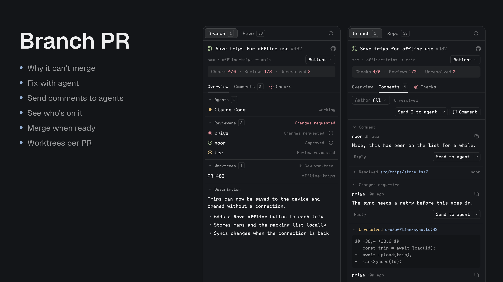

# Branch PR

A standalone native pull-request sidebar and repository browser for a person's existing Herdr window, serving GitHub pull requests and GitLab merge requests through one UI. It depends entirely on the local forge CLIs: every GitHub read and write runs `gh` with its login and every GitLab one runs `glab`, chosen by the remote's host, and a missing or logged-out CLI must surface as a plain panel message naming `gh auth login` or `glab auth login --hostname <host>`, never a generic failure. The sidebar shows PRs for the active checkout; All PRs opens a reusable normal center tab. Preserve the person's terminal tabs, layout, and shortcuts. No Workflow or Better Tabs dependency.

## What you see

Use a full-height theme-background panel with a 1px theme border, 10px rounding, and a 42px header. The branch sidebar header reads PR, with a PR selector, All PRs, GitHub, and refresh. It displays details directly for the matching checkout PR. The browser heading is Branch PR, with a right-aligned repository URL that opens on Cmd-click/Ctrl-click. A border separates the header from content. There is no browser footer or internal close button; normal tab controls close it. A layout framing lone panes should disable lone pane headers to avoid duplicated titles.

The browser's one filter row contains a flexible search field, All PRs/Created/Involved dropdown, and Open/Draft/Merged/Closed/All dropdown. The scrolling list has rounded raised cards with PR number/title, author, state, head branch, and involvement reasons. Load more follows the list.

Details show Back (browser only), state icon, number/title, GitHub link, branch/author metadata, and Description/Conversations/Checks tabs. Markdown descriptions, conversation cards, author/unresolved filters, timestamp/unread labels, quoted code context, reply and agent split actions, inline editors with Markdown preview, checks/workflows/jobs/steps, and failed logs fill the scrolling body. Branch view keeps a 34px status footer; browser does not. Pending/error notices remain visible above content.

Open PR icons are ansi2 green, drafts dim gray, merged ansi5 purple, closed ansi1 red. Check states have distinct success/failure/pending/running/skipped icons; running animates natively. Working/blocked/done/idle agent states are not PR states. Use theme colors and configured fonts, resolving em-like sizes through ui_font_size, then font_size, then 14. Do not hardcode a dark-only look.

## How it behaves

Branch discovery follows the active terminal cwd and machine. Match exact branch and source-repository remotes, prefer open matches, honor an explicit branch.<branch>.herdr-pr binding, and let people select multiple matches. Detached/no-repo/no-match cases must stay navigable. A selected pinned browser retains the checkout source for the sidebar.

All PRs opens one browser mod tab per space using tab.new; subsequent clicks select it with tab.select. Save source {cwd,on} and space in props. Guard rapid repeated opens; after closing via the tab controls, later opens recreate it. Own this behavior in Branch PR, not in another mod. Optional Better Tabs integration is configuration only, plus one inert shared-state write on init: mod-icons["branch-pr"] = the package's pull-request.svg path, so that tab bar can draw an icon on the browser tab. No assumptions about Factory center stacks or panel node IDs.

Browser repository detection prefers upstream, branch tracking remote, then origin, with a valid saved choice. Support GitHub.com HTTPS/SSH URLs. Git operations and file reads run on the source machine; GitHub requests and gh credentials stay local. Pin browser source even when other spaces are selected. Ignore stale async responses after source/selection changes.

Debounce search 450ms; queries shorter than three characters clear server filtering. GitHub owns matching, including body text and qualifiers. Involved unions assignment, review-requested, reviewed, and commented queries; deduplicate and retain independent pagination cursors. Preserve server order without another literal filter. Refresh reads roughly once per minute and on explicit refresh; do not redraw or query every frame.

Clicking a PR opens details. Preserve filters, selection, section, author/unresolved filters, expanded check groups, read snapshots, and reply drafts per repository/mode. Restore drafts after errors. Thread filtering keeps complete matching context. Reply and Quote reply open editors, never post until explicit Reply/Comment. Resolve/reopen obey GitHub permissions. On timeout, warn to refresh before retrying because a write might have succeeded.

Checks group by workflow/run, expand jobs/steps, normalize queued/running/passed/failed/skipped/cancelled states, and fetch failed logs on demand (last 60KB) while retaining links to full output. Render unread markers against stored fingerprints and mark loaded comments read explicitly or when leaving a visited Conversations section.

A Reviewers block sits under the detail row: the heading with `reviewDecision`, then a row per person with a state icon, login and state label, built from `latestOpinionatedReviews`, COMMENTED reviews and `reviewRequests`, with a waiting request winning. Its own query, so a failure leaves the PR readable and says it could not read reviewers. On an open non-preview PR, reviewed rows get a re-request icon, waiting rows a remove icon, and an Add button opens a login input. These send `reviewer {event: add|rerequest|remove, reviewer}`: REST `requested_reviewers` on GitHub, `reviewer_ids` and a `/request_review` note on GitLab. Logins are validated in the helper.

The detail row has a state action: a split button whose primary is the first allowed merge method (`mergeMethods`: the repository's settings on GitHub, merge and squash on GitLab) and whose menu holds the others plus Close; a plain Close for a draft, plain Reopen when closed, nothing when merged or in preview. A choice only opens a confirmation row naming the PR and branches, then Confirm sends `change-state {event, head}`: `gh pr merge --<method> --match-head-commit`, `gh pr close`, `gh pr reopen`, or GitLab `PUT .../merge {squash, sha}` and `PUT ... {state_event}`. Squash adds an editable message to the row, prefilled with the title, `(#N)` on GitHub, and description, sent as `--subject` and `--body` or GitLab `squash_commit_message`; a blank message cannot be confirmed. Failures keep the row and show the error; success reloads the PR and empties the list so it reloads too.

Live browser details list the PR's existing worktrees (branches bound by `branch.<name>.herdr-pr`, joined to `git worktree list --porcelain`), one row per checkout showing worktree and branch name; a click runs space.select for a space already on that folder, else space.new {folder, machine, tab}. New worktree proposes the PR head branch and `PR-<number>` as the worktree name, each suffixed `-k` past the PR's existing checkouts. The form captures source machine/space/repository/PR/head, accepts independent branch/worktree names, refuses existing branches/nonempty folders, fetches the PR head including forks, creates ~/.herdr/worktrees/<owner>-<repository>/<worktree-name>, records branch association, and runs space.new {folder, machine, tab: <worktree name>, argv?} so the checkout appears as a nested worktree space immediately and its first tab is focused. An Open with Popover dropdown on the form lists Terminal plus knownAgents({on}) entries that are installed; a chosen agent supplies argv: agent.run. A space-open failure retains the checkout for retry. Never discard working files.

Agent Send actions have editable prompts, source-space agent selection, and explicit submission. Draft fix & reply asks for read-only analysis/proposed fix/reply in a bound JSON result, not application or posting. Retain legacy .workflow/pr-proposals/ data paths for existing drafts, but never require or invoke Workflow. Validate request/repo/PR/commit/comment bindings and refetch context before posting a reviewed draft.

Commands: open-browser/toggle, refresh, back, open:<number>, checks/conversation/description, worktree, preview:<repo>#<numbers>, preview-browser:<repo>, and off variants. They reach shown copies only. Public previews use local authentication for public reads, never mutate GitHub or create worktrees, do not change Git remotes, and persist until disabled.

## Built from

One package with mods/branch-pr/main.js, typography.js, mod.json (place:none, title:Branch PR), SVGs, helper/go.mod/main.go/main_test.go, install.py, tests, docs, and preview. Build the dependency-free Go 1.23+ helper locally into the installed mod's bin/herdr-pr. Do not use a helper owned by another repo or ship a machine-specific compiled binary. The Python installer builds before copying, refuses unrelated collisions/symlinks, supports explicit updates, and checks the installed mod without modifying keys/layouts.

Native GPUI div/svg and gpui-base flex, input/textarea, Markdown, and Popover controls. Herdr supplies spaces, panes, agents, terminals, props, shared/setShared, exec, hc, home/appHome, theme, readTextFile, nextCommand, run, timers, native URL opening, and localStorage. Commands use tab.new/select and terminals/agents; no custom mod code is imported. The bundled helper runs local gh API/GraphQL/pr/run commands with explicit repository, validated request fields, JSON bodies, independent cursors, and a 26-second timeout.

## Watch out

Composer footers have Close, Start review / Add to review, and Reply / Comment (Save when editing). Add to review attaches a thread reply to the viewer's pending review via addPullRequestReviewThreadReply with pullRequestReviewId, creating the review first with addPullRequestReview when none exists; a general comment becomes the review body (addPullRequestReview with body, or updatePullRequestReview appending to the existing body). The detail query fetches viewerDidAuthor and viewerCanUpdate on reviews, viewerCanUpdate on comments, and pullRequestReview{id state} on thread comments. Pending thread comments and a pending review body get a Pending badge; empty pending review shells are hidden; a Submit review (N) primary button in the filter row runs submitPullRequestReview with event COMMENT. Comments with viewerCanUpdate show Edit, which reuses the composer prefilled with the body and saves through updateIssueComment, updatePullRequestReviewComment, or updatePullRequestReview by kind. The Author filter is a native Popover dropdown mirroring the status filter, with arrow/enter keyboard selection.

Before installation explain Git/gh/hc execution, repository/proposal file reads, GitHub access through local credentials, and explicit actions that post/resolve, merge/close/reopen PRs, change reviewers, create worktrees/branches/config, open terminals, and send prompts. Read every source before installing. Copy only runtime code/assets and the built helper; docs/tests/recipe do not belong in the installed mods folder. Go/Python are development/install dependencies, not native JS runtime dependencies.

Herdr's shipped layouts (`main`, `terminals`, `win98`) are read-only and restored on every start, so edits to them are lost; the mod only shows in a layout the person owns. Check `shared("layout")`: if the shown layout is shipped, clone it with `herdr-app do layout.clone '{"name":"<shown>","as":"<name>"}'` (which switches to the clone) and edit the clone; if the person already has their own layout, ask whether to add the mod to it or to create a new layout. Say which layout now holds it. Replace only the PR slot reference and preserve node IDs, dimensions, sibling panels, and keys. Branch PR self-opens branch-pr mod tabs and uses mods/branch-pr asset/helper paths; rename all consistently on an unrelated name clash. A layout node may keep its old pull-requests ID without depending on that old mod. No Node/DOM/CSS, retained callback contexts, top-level await, timers for animation, or render-time shared-state writes.

Repositories are `owner/name` on github.com and `host/group/project` on any other host, which the helper serves as GitLab; the host prefix travels in bindings and keys. The GitLab backend reshapes REST responses into the GitHub-shaped objects the UI renders: notes to comments, positioned discussions to threads, approvals to APPROVED reviews, draft notes to the PENDING review (ids `draft-note:<id>` for the summary and `draft:<id>` for replies, published by bulk_publish and optionally approve), pipeline jobs to checks with `runId`, and job traces with ANSI stripped to failed logs. REQUEST_CHANGES is refused on GitLab. GitHub Enterprise is unsupported. Search indexing is eventually consistent. Herdr native initial checks do not cover every deferred render/async result. Conversation pagination is bounded and fails visibly rather than silently truncating; large failed logs are limited. A new mod identity may require copying old local state to retain drafts during migration; never overwrite existing personal state blindly.

A `settings` block in the installed `mods/branch-pr/mod.json` carries the person's preferences, merged over the mod's defaults by the shared `settings.js` with unknown keys and wrong types reported; the keys are listed in README.md. Durations are strings such as `60s`, sizes such as `60KB`. Version lives beside it in the same file.

## Done when

- Node tests, Python installer tests, Go tests/vet, and herdr-app check pass.
- Package has no Factory/Better Tabs/Workflow helper/layout dependency.
- A missing or logged-out `gh` produces the explicit install / `gh auth login` message; pending replies and summaries go to the viewer's review and Submit review publishes them; own comments are editable through the matching mutation; the author filter is a Popover dropdown.
- Live sidebar and reusable browser tab render without errors; normal tab-close works and reopening creates one tab.
- One browser heading has the modifier-click repository URL and bottom border, with no duplicate lone-pane heading, footer, or internal close button.
- Local/remote source capture stays pinned through tab and space switches.
- PR discovery handles fork heads, explicit bindings, detached/no-match states, and unavailable remotes.
- Filters/search/pagination, saved views, thread/reply/check UI, drafts, errors, and stale-response invalidation work.
- Preview cannot write; tests mock GitHub mutations and never post automatically.
- Worktrees validate names/existing state, open as a new space with the chosen terminal or installed agent in the first tab, and preserve completed checkouts on space-open failure.
- Agent proposal binding rejects stale context and posting remains an explicit reviewed action.
- Installed layouts/keys still work after removing the old bundled PR mod and helper.
