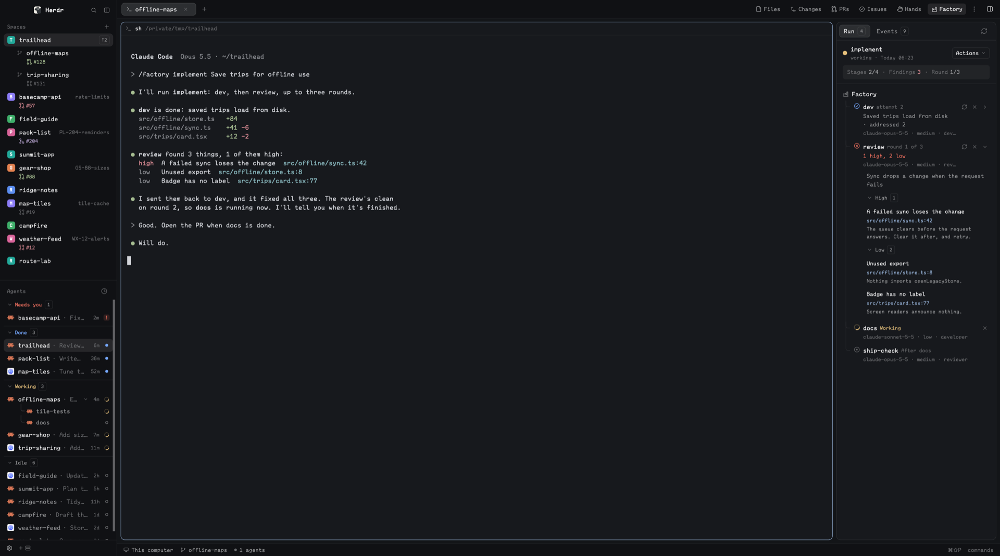

# Estro

*Estro* is Esperanto for the one in charge. A layout for directing agents: every space and agent on the left, the session you're with in the middle, and on the right everything you need to check their work and hand them more.



This file is the brief: enough to build Estro from an empty folder. The files next to it are one build of it.

## What you see

A row filling the window, with no title bar, `canvas` behind and 1px `border` dividers. Terminals have 14px and 12px padding.

**Sidebar, 268px.** Herdr's `workspace-chrome` brand block at 46px. Below, sharing the height equally, the spaces list and the agents list, both from Better Sidebar: branches on the same line as space names, worktrees nested under their repository, and a pull request's state under its space. Better Sidebar's one-line footer closes it at 37px.

**Work area, the rest.** At the top, 42px, Better Tabs with Better Sidebar's 36px panel toggle at the far right. In the middle, the active tab's terminals, with a 368px panel on the right. At the bottom, Herdr's 28px `workspace-status`.

**The panel** is a stack of one view at a time, chosen from the toolbar in Better Tabs:

| Button | Mod | For |
| --- | --- | --- |
| Files | Herdr's `files` | Browsing |
| Changes | Better Changes | What changed, staging, commits and diffs |
| PRs | Branch PR | What's in the way of a merge, and handing it to an agent |
| Issues | Branch Issue | Linear issues, and starting work on one |
| Hands | Hands | What an agent did in other apps, and what it captured |
| Factory | Factory | Staged agent runs, as a tree of sessions |

The toolbar's buttons are `panel` actions with `container: "panel"` and `stack: "panel-body"`, and each space remembers its panel through `rememberPanels`.

## Installing it

Copy `layouts/estro.json` and each folder in `mods/`, as usual. **Four of the mods also need a helper built, which copying can't do**, and this folder holds no binaries. Their source is in [munza/herdr-mods](https://github.com/munza/herdr-mods). For each that the person wants:

```sh
git clone https://github.com/munza/herdr-mods
cd herdr-mods/branch-pr && go -C helper run ./install
cd ../branch-issue && go -C helper run ./install
cd ../hands && go -C helper run ./install
cd ../factory && go -C helper run ./install
```

Add `--update` where the mod is already installed. Each installer builds its helper and copies its mod, so it replaces the copy from this folder, and it refuses to overwrite an unrelated mod. Read each mod's README first and tell the person what it can do:

- **Branch PR:** runs Git, `gh` and `hc`, and on a click can merge, comment and create worktrees. Needs Go 1.23+ and a logged-in `gh`.
- **Branch Issue:** reaches Linear with `LINEAR_API_KEY` from the environment, runs Git and `hc`, and on a click can write to Linear and create worktrees. Needs Go 1.23+ and that key.
- **Hands:** needs macOS 14+, Go 1.23+ and the Xcode command line tools. Granting Herdr Accessibility and Screen Recording lets anything in a Herdr terminal operate every app. It also links `~/.local/bin/hands`.
- **Factory:** starts agent sessions and sends them messages, and its default `dev` stage auto-accepts file edits. Needs Go 1.23+, `hc` and Claude Code. It also writes default workflows to `~/.config/herdr-mods/factory/` and the `/factory` skill to `~/.claude/skills/factory/`.

A mod whose helper isn't built says so in its own panel. Anyone who doesn't want one can drop its button and block from the layout. Better Sidebar's `keys.json`, which binds Cmd+Shift+B to the panel toggle, is optional and lives in that mod's folder in the same repository.

Then `herdr-app check` each mod and `layout.switch {"name": "estro"}`.

## Built from

`layouts/estro.json`, with `cloned_from` Herdr's `main`, and `mods/`: `better-sidebar`, `better-tabs`, `better-changes`, `branch-pr`, `branch-issue`, `hands`, `factory`. `files`, `workspace-chrome` and `workspace-status` ship with Herdr. Each mod's own `RECIPE.md` in [munza/herdr-mods](https://github.com/munza/herdr-mods) is the brief for that mod. `sync.sh` and `tests/` keep this folder's copies in step with those.

## Watch out

Never overwrite a mod or layout already there under the same name. The panel is 368px because the mods are drawn for that width.

## Done when

- `herdr-app check` passes for each mod, and the layout shows with all six panel buttons.
- Each button opens its panel, and a mod with a helper shows real data or says what's missing.
