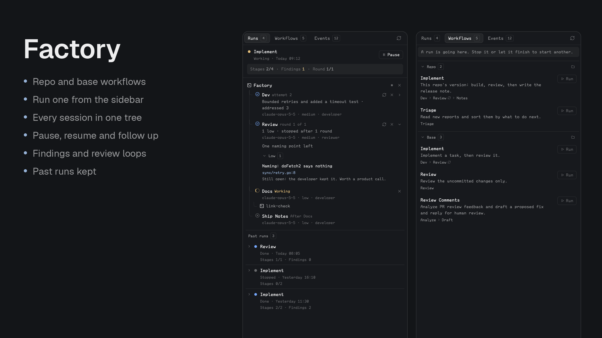

# Factory

Staged agent runs for [Herdr Desktop](https://herdr.dev/). A Claude Code session becomes the orchestrator of a named workflow, such as developer then reviewer, and a sidebar shows the run with every session nested under it. Start one from the Workflows tab, or by asking an agent with `/factory implement <task>`; the orchestrator never blocks, so you can keep talking to it while stages run.



- **Runs tab:** a run that is working or paused is pinned at the top with its controls. Finished runs are a list below, newest first; each shows its stats, and opening one shows the same tree. The last run keeps its controls, and older ones are read-only. Each view has the workflow, a strip with stages done, findings open and the loop's round, then a tree. Factory, the orchestrator, is the root, each stage nests under it, and any helper a stage started with `hc run` nests under that stage. Click any of them to open its session.
- **Each stage** shows its live state (working, needs you, session ended, done, failed, stopped, queued), its result, and its model, effort and role. A chevron opens a done stage's result, with findings in collapsible groups by severity, each with its file and detail, and its replies.
- **Follow up** from a done stage's result: write what you want next, and it goes to that stage's live session, which keeps its context. The stages after it run again.
- **Workflows tab:** everything this repo can run, in two groups, **Repo** then **Base**, each with a folder icon that opens where its file lives. Each shows its description and stages, and hovering a stage shows its model, effort and role. **Run** asks for the task, then starts a new Claude session in a new tab to orchestrate it. It is disabled while a run is going.
- **Events tab:** the run's log, newest first, each with a `workflow:stage` badge, grouped by day, and filterable by stage.

The sidebar never shows a task or follow-up afterwards. With no task, `/factory implement` takes it from the agent's own conversation, and asks if there's no clear one, so you can have that conversation first. To read what a stage was told, open its session. `/factory help` lists your workflows in an agent.

## What you can do

| Control | Where | What it does |
| --- | --- | --- |
| **Run** | Workflows | Asks for the task and which session runs it: a new Claude session in its own tab, or one already running in this folder, which keeps its context and gets `/factory` as a message. That session runs the workflow. Disabled while a run is going. Ends the last run's sessions, apart from `reuse` stages. |
| **Pause** / **Resume** | run | Pause interrupts working stages, keeps their sessions and starts nothing new. Resume tells them to carry on, then the run continues. Resume needs a live orchestrator. |
| **Stop all** (■) | Factory row | After you confirm, interrupts working stages and stops the run. The sessions stay open, and `/factory continue` picks it up. |
| **Close** (×) | Factory row | After you confirm, ends every stage session and stops the run. Factory's own session stays. |
| **Open folder** (folder icon) | Workflows, Repo and Base headings | Opens the folder holding that group's `workflow.json`. |
| **Run again** (↻) | stage | Sends the stage its message again, in the same session if it's alive, and queues the stages after it. Needs a live orchestrator, since that's who the stage reports to. |
| **Close** (×) | stage | Ends that session. Asks first if it's working. |

Ask the agent for the rest: `/factory continue` picks up a run that stopped or lost its orchestrator, keeping stages already done, and `/factory help` lists them.

## Install

Copy this prompt into your Herdr agent:

> Read ~/.config/herdr-app/AGENTS.md, then add this mod: https://github.com/munza/herdr-mods/tree/main/factory

Requirements: Herdr, **Go 1.23+** to run the installer and build the helper, herdr-core (`hc`), and Claude Code (another agent can orchestrate by following the installed skill file). Stages can also run the Codex CLI.

Read [RECIPE.md](RECIPE.md) and the source before installing. On a `/factory` command or a click on a stage, Factory **starts and ends agent sessions and sends them messages**. The default `dev` stage uses `--permission-mode acceptEdits`, so it edits files in the repo without asking; remove that from `args` to be asked. Every Claude stage may run `hc send` and write under `.herdr-factory/` without asking, so it can report.

From this folder:

```sh
go -C helper run ./install          # first install
go -C helper run ./install --update # later
```

The installer builds the helper, copies `mods/factory/` to `~/.config/herdr-app/mods/factory/`, runs `herdr-app check`, writes the default workflows and templates if missing, and installs the `/factory` skill to `~/.claude/skills/factory/` unless a different skill is there. It doesn't edit layouts or keys.

### Place the sidebar

The manifest has `place: none`, so add it to a layout you own:

```json
{ "id": "factory", "type": "block", "content": { "mod": "factory" } }
```

With Better Tabs, a button can open it (`target` is that block's layout ID):

```json
{
  "id": "factory",
  "label": "Factory",
  "icon": "mods/factory/icons/factory.svg",
  "action": { "type": "panel", "container": "panel", "stack": "panel-body", "target": "factory" }
}
```

## Configure workflows

Everything lives in `~/.config/herdr-mods/factory/`, created on first use and never overwritten:

```text
~/.config/herdr-mods/factory/
  workflow.json
  templates/developer.md, reviewer.md, pr-analyst.md, pr-responder.md
```

`workflow.json` names your workflows:

```json
{
  "workflows": {
    "implement": {
      "description": "Implement a task, then review it.",
      "stages": [
        { "id": "dev", "role": "developer", "agent": "claude", "model": "claude-opus-5-5", "effort": "medium", "args": ["--permission-mode", "acceptEdits"] },
        { "id": "review", "role": "reviewer", "agent": "claude", "model": "claude-opus-5-5", "effort": "medium", "after": ["dev"], "loop": { "with": "dev", "max": 3 } }
      ]
    }
  }
}
```

| Stage key | Meaning |
| --- | --- |
| `id` | The name shown in the sidebar: 1-24 of `a-z 0-9 - _`. Stages run in file order. |
| `role` | A template in `templates/`, without `.md`. |
| `agent` | `claude` (default) or `codex`. |
| `model`, `effort` | Launch settings, and the sidebar shows the model. A Claude stage with no `model` uses `claude-opus-5-5`. Effort is `low`, `medium`, `high`, `xhigh` or `max`, and the model must support it. |
| `args` | Optional extra arguments for the agent's command line. |
| `message` | Optional first message, with `{task}` replaced by the task. Without it a `reviewer` is told to review the uncommitted changes for the task, and any other role gets the task itself. |
| `after` | Shown in the sidebar while the stage waits. |
| `loop` | `{"with": "<earlier stage>", "max": <rounds>}`: see Loops. |
| `session` | `new` (default) starts a fresh session each run. `reuse` keeps the last run's live session for the same stage id if its `agent`, `role`, `model`, `effort` and `args` are unchanged, and tells it a new run has started. |

A workflow in your home file can also set `extra_args`, for a new Claude session the **Run** button starts. A session already running keeps the flags it has. Stage sessions use each stage's own `args`. A session you start yourself with `/factory` keeps the mode it already has.

```json
"implement": { "extra_args": ["--permission-mode", "auto"], "stages": [ ... ] }
```

A repo can add workflows in `.herdr-factory/workflow.json`, in the same format. If it uses a name your base config also has, the plain name runs the repo's, and `base:<name>` runs yours, so both stay available. A git worktree with no such file of its own reads the main checkout's. A repo file can't set `args` or `extra_args`, so a cloned repo can't choose flags such as one that skips permission prompts. Instead, a repo stage takes the `args` you set for the stage with the same id in your own workflow of the same name, and a repo workflow takes the `extra_args` of your workflow of the same name.

## Loops

```json
{ "id": "review", "role": "reviewer", "loop": { "with": "dev", "max": 3 } }
```

When `review` reports findings, the live `dev` session gets them, pointing at the result file, and then the live `review` session checks again. This stops when there are no findings or after `max` rounds, and only then does the run move on. A follow-up or rerun gives a loop its rounds back. `with` must name an earlier stage.

## Follow-ups

Use **Follow up** on a done stage, or ask the orchestrator, such as `/factory fix the review findings`. It runs `factory followup <stage> "<task>"`, which reopens the run, even a finished one, and queues the stages after it. A new session starts only if the stage's is gone. A follow-up waits until no stage is running.

## Stage permissions

**Needs you** on a Claude stage usually means a permission prompt, which only you can answer. `args` in your `workflow.json` sets what a stage may do without asking:

```json
"args": ["--permission-mode", "acceptEdits", "--allowedTools=Bash(go test:*) Bash(git diff:*) Bash(git status)"]
```

Keep the `=` form for `--allowedTools`. A list you allow runs unattended, so keep it to what the stage needs.

## Add a role

A role is a Markdown file in `templates/`, whose body becomes the agent's standing instructions:

```markdown
---
name: scholar
description: Answers a question and writes the answer as a cited note.
---
You are the scholar in a workflow. ...
```

Each role follows the result contract, which is how the orchestrator and the sidebar learn what happened:

- When its message says so, write `.herdr-factory/<stage>-<attempt>.json` with `{"summary": "<at most ten words>"}`.
- A reviewer adds `"findings": [{"id", "severity": "critical|high|medium|low", "file", "line", "title", "detail"}]`. An empty list means approved.
- A developer answering findings adds `"replies": {"<finding id>": "<what it did>"}`.
- Then report as the message asks, with one `hc send` line, and stop.

## The `factory` command

The orchestrator and the sidebar both call it, and it's the only writer of `.herdr-factory/run.json`. `~/.config/herdr-app/mods/factory/bin/factory help` lists its commands. Run it from the repo root.

The session running the stages has its tab named **Factory**, and each stage session takes its stage's name, such as `dev`. If another repo has a live `dev`, this one becomes `dev-2`, because `hc` names must be unique.

One run goes at a time per repo, and a new run ends the last run's sessions, apart from those `reuse` stages keep. `.herdr-factory/` ignores itself in git, and a new run moves the last run and its result files to `.herdr-factory/runs/`. Past runs aren't pruned, and deleting that folder only loses the history.

## Settings

The installed `mods/factory/mod.json` has a `settings` block, kept across `--update`:

```json
"settings": { "refresh": { "run": "1500ms" } }
```

`refresh.run` is how often a visible sidebar rereads the run file, never closer than 500ms. A hidden sidebar reads nothing.

## Limits

A space on another machine shows a notice instead of the run, because `factory` and the run file are read on this computer only. Closing a stage doesn't tell a stage after it to start: use `/factory continue` or Run again. The first message goes on the agent's command line, so if a trust dialog appears the stage shows **Needs you** until you answer it.

## Development

```sh
node --test tests/*.test.cjs
(cd helper && go test ./... && go vet ./...)
herdr-app check "$HOME/.config/herdr-app/mods/factory"
```

`mods/factory/main.js` lists what's where. `run/model.js` says what a run's record means, `run/` reads, `actions/` starts and changes things through the helper, `views/` draws with `views/ui.js`, and `icons/` holds the icons. `helper/` is the `factory` command, with `install/` for the installer and `defaults/` for the workflows and templates it writes. Tests use stand-ins for Herdr and `hc`, so also look at the running app.

See [LICENSE](../LICENSE) and [NOTICE](../NOTICE) for attribution.
