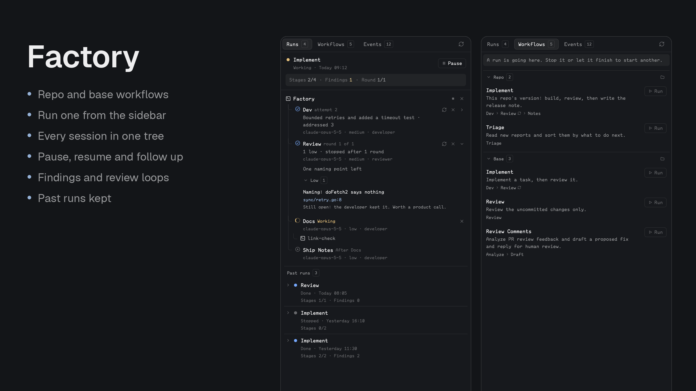

# Factory

A Herdr mod for staged agent runs, for directing agents rather than doing the work. A Claude Code session is the orchestrator, `factory` records the run in `.herdr-factory/run.json` and controls the stage sessions through `hc`, and a sidebar shows the tree. Judge any addition by whether it helps someone see where a run stands or redirect it.

## What you see

It follows Better Changes and Branch PR, in one framed sidebar panel, radius 10, with a 42px header of pill tabs, Run [stages] and Events [n], and refresh on the right. The tab is remembered.

With no run, Run says so and points to Workflows. A Workflows tab lists what this repo can run in two collapsible groups, Repo then Base, whose headings have a right-aligned folder icon opening that group's folder, with a rule above Base, and above Repo too under a notice, and only space between workflows. Why Run is off shows as a notice: `raised` at half strength, rounded, like the stat strip. Each row has its description, its stages in order and a Run button. A base workflow the repo also names runs as `base:<name>`. Run opens a required task box, and under it a dropdown on the left with Close and Start run on the right. The dropdown offers New Claude session by default, then each Claude session in this folder that isn't one of the run's stages. A new one is `claude` in a new tab with `/factory <name> <task>`; an existing one gets that through `hc send`. That session is the orchestrator. Run is disabled while a run is working or paused, and while one is starting.

The first tab is Runs. A run that is working or paused is pinned at the top; finished runs are a list below it, newest first, each a row with chevron, dot, name, state and time, and its stats as plain small print below, opening to the same tree indented so Factory's icon sits under the dot. `factory run` archives the last run and its results to `.herdr-factory/runs/<digits>/`, and `factory history` lists them with no task. Only the last run has controls; older ones are read-only. A pinned run has a fixed block with a rule under it: a colour dot, the workflow's name over its state and start time in small print, and an outlined Pause control on the right, Resume in `accent` while paused, shown only while the run is going or paused, then a strip of `raised` at half strength, rounded, with Stages done/total, Findings from finished reviews, left out while a review waits to check again (ansi1 with critical or high, ansi3 otherwise, ansi2 at none) and Round during a loop, separated by dots. Stop all and Close, icon buttons on the right of the Factory row, confirm in a block under it: Stop all interrupts working stages and keeps their sessions, and Close ends the stage sessions but never Factory's own. Workflow and stage names show in title case.

Below it scrolls the tree, joined by 1px lines: the Factory row with the orchestrator's program icon, then each stage with a status icon; its name and what it's doing; its result; and `model · effort · role` in small print. A live stage's row opens its session. On the right are rerun and close icons when they apply, and a chevron on a done stage opening its result: the summary, findings in collapsible groups by severity with title, `file:line` in the code font and detail, replies, and Follow up. Helpers a stage started nest below it.

Events has a filter row with a chooser of All events, The run itself and each stage, then the log, newest first, in collapsible groups by day, with the time in the code font.

Missing `hc` or `claude`, or a helper failure, shows in red under the header. A space on another machine gets a notice.

## How it behaves

The sidebar never shows a prompt. A hidden panel reads nothing, checked through `layout()`. The helper is the only writer of the run file, holds a lock for each command, and replaces the file whole.

Pause interrupts working stages with `hc interrupt` and starts nothing new; Resume tells them to carry on.

## Built from

`mods/factory/`: `main.js`, `settings.js` (shared between this repo's mods), `mod.json` (`place: none`, title Factory), `mod.schema.json` (its settings with their defaults, which the code's `DEFAULT_SETTINGS` must match), `run/` (`model.js`, `reads.js`), `actions/` (`commands.js`, `menus.js`), `views/` (`ui.js`, `days.js`, `run.js`, `workflows.js`, `empty.js`, `events.js`), `icons/`. `helper/` is a standard-library Go program with `defaults/` embedded, split into `main.go`, `run.go`, `config.go` and `session.go`; `helper/install/` builds it to `mods/factory/bin/factory`, writes the defaults and installs `skills/factory/SKILL.md`.

## Watch out

Herdr's shipped layouts are read-only, so the sidebar only shows in a layout the person owns. Never overwrite an unrelated mod or skill on a name clash. Say before installing that the default `dev` stage auto-accepts file edits, and that `args` in `workflow.json` controls this. `herdr-app check` draws only the empty state, so look at the running app too.

## Done when

- `go test ./...` and `go vet ./...` in `helper/`, and `node --test tests/*.test.cjs`, pass, and `herdr-app check` passes.
- `~/.config/herdr-app/mods/factory/bin/factory list` prints the default workflows.
- The sidebar points to Workflows in a space with no run, and `/factory <workflow>` in a Claude session there nests the stages under the orchestrator.
