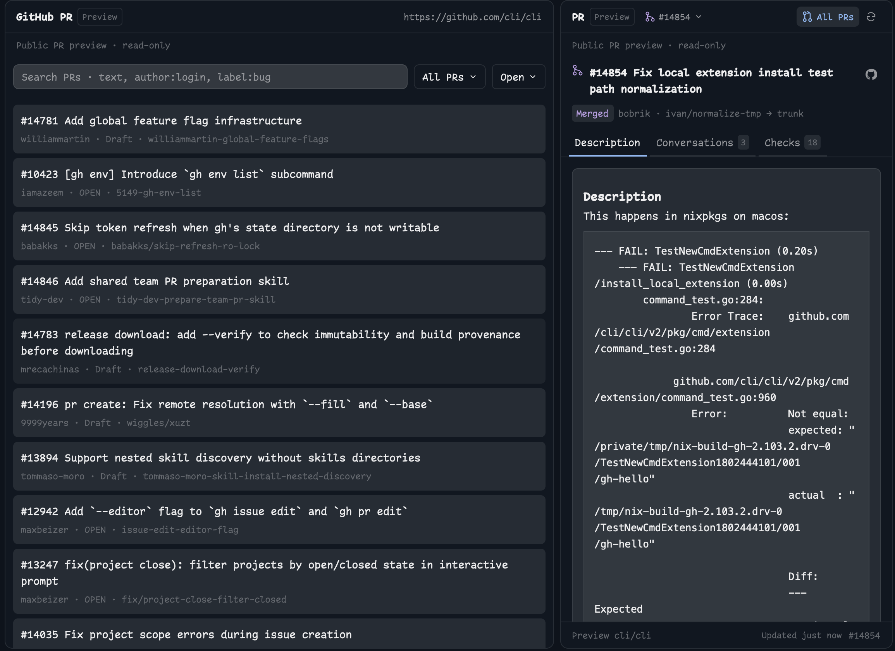

# GitHub PR

A standalone native GitHub pull-request sidebar and repository browser for [Herdr Desktop](https://herdr.dev/).



- **Branch sidebar:** PRs matching the current checkout, with Open, Draft, Merged, and Closed state icons.
- **All PRs:** one reusable normal browser tab per space. Close it with the tab bar's control or your existing tab-close shortcut.
- Search, **All PRs / Created / Involved** scopes, and Open/Draft/Merged/Closed/All filters.
- PR descriptions, conversations, reviews, threaded replies, unread markers, and GitHub Actions checks/jobs/failed logs.
- Explicit comment/reply/resolve/reopen controls, agent handoff prompts, optional draft-fix proposals, and PR worktree creation.
- Local and remote spaces: Git/file operations run on the source machine, GitHub queries use local `gh` authentication.
- No dependency on Factory, Better Tabs, Workflow, or another custom mod.

## Install

> Read ~/.config/herdr-app/AGENTS.md, then add this mod: https://github.com/munza/herdr-mods/tree/main/github-pr

Requirements: Herdr with native mod tabs, Python 3 for the installer, **Go 1.23+** to build the helper, Git on source machines, and a local **GitHub CLI** authenticated with `gh auth login`. Agent actions additionally use `hc` and a live agent in the source space.

**This mod depends entirely on the GitHub CLI.** Every read and write goes through `gh` on this computer, using its login. There is no token setting and no other transport. If `gh` is missing or logged out, the panel shows a plain message saying so (`GitHub CLI (gh) is not installed…` or `GitHub CLI is not logged in. Run gh auth login…`) with a Retry button; nothing else works until that is fixed.

Read [RECIPE.md](RECIPE.md) and the source before installation. The helper runs `gh` against GitHub using your existing credentials; the mod runs Git/`hc` and reads repository/proposal files. Explicit user actions can **post comments and replies, resolve/reopen review threads, fetch PR heads and create Git worktrees/branches, write PR-association config, open terminals, and send agent prompts**. Preview mode disables GitHub writes and worktree creation. Never test mutations against a user's repository without their instruction.

From this package directory:

```sh
python3 install.py
# Later, update an existing installation owned by this package:
python3 install.py --update
```

The installer builds the local helper without third-party Go dependencies, copies **only** `mods/github-pr/` and the helper to `~/.config/herdr-app/mods/github-pr/`, then runs `herdr-app check`. It does not edit layouts or keys. `HERDR_APP_HOME` or `--app-home` selects a different config home. It refuses an existing name unless `--update` is explicitly supplied for an existing GitHub PR manifest; unrelated names and symlinks must not be overwritten. If renaming the mod, update its self-opening mod IDs, asset paths, helper path, and installer consistently.

The helper is installed at `mods/github-pr/bin/herdr-pr`, not a Workflow-owned global path. Go is needed only to build/update it, not at runtime. Do not copy a compiled binary from a different OS/architecture.

### Place the sidebar

Herdr's shipped layouts (`main`, `terminals`, `win98`) are read-only and restored on every start, so the mod only shows in a layout you own. If you are on a shipped layout, your agent clones it and edits the clone; if you already have your own layout, it asks whether to add the mod there or create a new layout. Replace an existing PR/sidebar block's content, preserving its ID and dimensions:

```json
{ "mod": "github-pr", "props": { "mode": "branch" } }
```

The manifest has `place: none`, so copying alone does not dock a second sidebar. If no PR slot exists, add one to a personal layout (about 368px wide is a useful start). The **All PRs** button opens/selects a browser tab directly; no toolbar integration is required.

### Open a browser tab

```sh
herdr-app do tab.new '{"name":"All PRs","mod":"github-pr","props":{"mode":"browser"}}'
```

The default role is browser. The sidebar's **All PRs** action supplies `{mode:"browser",space,source:{cwd,on}}`, pinning the checkout and machine captured when opened. A manually created browser without source props follows the selected space. Repeated opens through the sidebar reuse the current space's existing GitHub PR mod tab. A brief pending guard prevents rapid clicks from opening duplicates.

The browser has **one heading**, a right-aligned repository URL (Cmd-click/Ctrl-click opens GitHub), and a border beneath. There is no internal close button and no browser footer. Use normal tab controls. If a layout also frames lone panes with a header, set its tab block's `pane.lone` to false to avoid a duplicate title row; split-pane headers can remain.

### Optional Better Tabs integration

Better Tabs is optional. On start the mod publishes its pull-request icon under the shared `mod-icons` map so a Better Tabs bar shows it on the All PRs tab; without Better Tabs that entry is inert. A toolbar panel action points at the **layout node ID**, which need not be `github-pr`:

```json
{
  "id": "prs",
  "label": "PR",
  "icon": "mods/github-pr/pull-request.svg",
  "action": { "type": "panel", "container": "panel", "stack": "panel-body", "target": "pull-requests" }
}
```

A Better Tabs command alias can open a browser even when the sidebar is hidden:

```json
{
  "commands": {
    "toggle-prs": { "type": "mod-tab", "mod": "github-pr", "name": "All PRs", "props": { "mode": "browser" } }
  }
}
```

Bind `better-tabs.toggle-prs` in `keys.json` if desired, preserving existing shortcuts. This opens/selects a tab rather than closing it. The package installs no shortcuts.

## Repository and PR discovery

The branch sidebar follows the active terminal's cwd, falling back to its space folder. Selecting a pinned GitHub PR tab retains its captured checkout rather than redirecting the sidebar to the space's original folder. Read the symbolic branch and any explicit `branch.<branch>.herdr-pr` association; otherwise inspect GitHub remotes, match exact head branches and source repositories (including forks), and prefer open matches. Choose among multiple PRs with the header selector. Detached HEAD and no-match cases have a usable empty state.

The browser's initial repository preference is `upstream`, then the branch tracking remote, then `origin`; valid saved remote choices are restored. GitHub.com URLs are supported, not GitLab or GitHub Enterprise. Git reads run on the source machine; the helper and authenticated GitHub calls run locally with explicit repositories. GitHub search indexing and minute-level refresh mean the display is not instantaneous.

## Browse, discuss, and check

Search debounces for 450ms and starts at three characters; GitHub matches titles/bodies and qualifiers such as `author:alice` or `label:bug`. Clear/shorten the query to restore unfiltered results. **Involved** combines assignment, requested reviews, submitted reviews, and comments; matches are deduplicated with reasons. **Load more** preserves independent cursors for involvement categories.

PR details provide Description, Conversations, and Checks. Conversation cards show authors, timestamps, resolved state, and bounded code context. The **Author** filter is a native dropdown with keyboard selection; author/unresolved filters preserve complete matching threads. **Reply / Quote reply** opens an editor with Markdown preview; no write occurs before explicit Reply/Comment. Drafts survive errors/navigation. A timeout may follow a successful server write: refresh before retrying.

**Pending reviews.** Every composer has a second button, **Start review** or **Add to review**, that holds the comment in your unsubmitted GitHub review instead of posting it. Thread replies join the review as pending review comments; a general comment becomes the review summary, and later ones append to it. Pending items show a **Pending** badge, the summary appears as a *Review · Pending (not submitted)* card, and a **Submit review (N)** button in the filter row publishes everything at once as a comment review. Until then only you can see them, on GitHub too.

**Editing.** Comments, replies and review summaries you wrote show an **Edit** control. It opens the same editor prefilled with the current text; **Save** updates the comment on GitHub. Editing is disabled in preview mode. Every comment card also has **Copy link**, which puts the comment's GitHub URL on the clipboard.

Checks show overall status and grouped workflows, jobs, steps, and failed logs (last 60KB), with links to full GitHub output. Open/draft/merged/closed use green/gray/purple/red icons; queued/running/passed/failed/skipped/cancelled check states have distinct icons. Agent working/blocked/done/idle are separate from PR state and do not recolor it.

Unread markers compare saved comment fingerprints. **Mark N read**, or leaving a visited Conversations view, updates the local snapshot. Browser filters, selected PR, sections, filters, expanded checks, and reply drafts are saved locally. The branch sidebar retains a status footer; the browser intentionally has none. Failed reads retain cached state where possible and offer Retry, never retrying writes automatically.

## Worktrees and agent actions

**Worktrees** appear in live browser details: every checkout whose branch is associated with the PR is listed with its worktree and branch name, and clicking a row switches to that worktree's space, or opens one when none is running. A PR may have any number of worktrees; **New worktree** proposes the next free branch name. Creation Edit branch/worktree names independently; creation fetches the selected PR head (including forks), refuses existing branches and nonempty folders, creates a checkout under `~/.herdr/worktrees/<owner>-<repository>/<worktree-name>` on the source machine, associates its branch with the PR, and opens the checkout as a **new space**, which the spaces sidebar nests under the repository at once. An **Open with** dropdown on the form chooses what runs in that space's first tab: a terminal, or any installed agent from Herdr's program table; that tab takes focus. If opening the space fails, the checkout is retained and the Open button retries only that step. Public previews cannot create worktrees.

**Send to agent** offers agents in the source space and an editable prompt containing the PR/comment context. Only Send delivers through `hc`. **Draft fix & reply** asks that agent for read-only analysis and a proposed fix/reply; results are stored under `.workflow/pr-proposals/` for compatibility with existing drafts. This is just a local data path: the Workflow mod/recorder is **not required** and is never invoked. Proposals bind repository, PR, commit, and comment context; stale results cannot post. Review/edit the draft before the explicit GitHub write.

## Commands and previews

Commands reach shown mod copies, per Herdr's command-delivery rules:

- `github-pr.open-browser` (alias `toggle`): open/select the reusable browser tab.
- `github-pr.refresh`, `github-pr.back`, `github-pr.open:123` (browser), `github-pr.checks`, `github-pr.conversation`, `github-pr.description`, `github-pr.worktree`.

Read-only public previews:

```sh
herdr-app do 'github-pr.preview:cli/cli#14854,14858'
herdr-app do 'github-pr.preview-browser:cli/cli'
# Restore live sources:
herdr-app do 'github-pr.preview:off'
herdr-app do 'github-pr.preview-browser:off'
```

Preview settings are shared and persist until disabled. They do not change remotes. There is no merge, checkout-discard, or automatic GitHub write action.

## Development

```sh
node --test tests/*.test.cjs
python3 -m unittest discover -s tests
(cd helper && go test ./... && go vet ./...)
herdr-app check "$HOME/.config/herdr-app/mods/github-pr"
```

`main.js` owns native UI, repository state, commands, and async invalidation. `typography.js` resolves font settings. `helper/main.go` is the JSON bridge to `gh` with validated requests and a 26-second timeout. `install.py` builds/copies only this package. Tests use mocked API calls, not live GitHub writes; initial native checks do not exercise every deferred/async state, so inspect the running app too.

See [LICENSE](../LICENSE) and [NOTICE](../NOTICE) for attribution.
