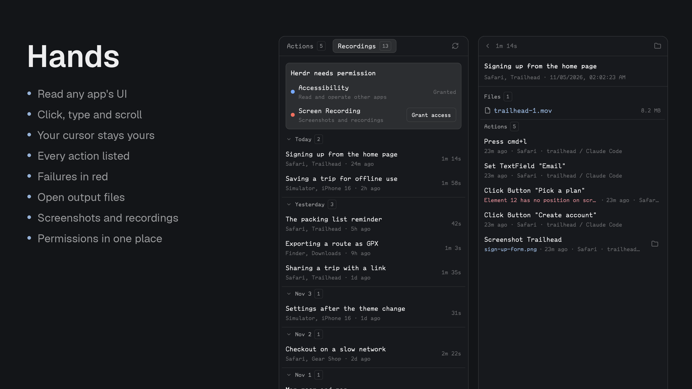

# hands

Hands for a coding agent on the rest of the Mac, as a Herdr mod for [Herdr Desktop](https://herdr.dev/): a small `hands` command that lists apps and windows, reads an app's accessibility tree as numbered lines, clicks, types, presses keys, sets values, scrolls, screenshots a window and records the screen. Plus a tiny pane that shows whether Herdr holds the two permissions it needs.



- **See:** `hands see --app Finder` prints the app's accessibility tree, one numbered element per line with role, title, value and frame, and saves that snapshot. `--find text` shows only matches with their ancestors; `--window title` narrows to one window; `--max` caps the output.
- **Act:** `hands click 12`, `hands set 7 "query"`, `hands focus 7`, `hands scroll 3 --dy -5` act on elements from the last snapshot through the Accessibility API, falling back to synthetic mouse or keyboard events when an element has no action. `hands type "text"` and `hands key cmd+shift+s` send keyboard input. `hands click --at 400,300` clicks a screen point.
- **Capture:** `hands shot --app Safari out.png` screenshots one window through ScreenCaptureKit. `hands record start demo.mov`, then `hands record stop`, records the whole screen through macOS's own `screencapture`; add `--app Safari` to record just that app's window through ScreenCaptureKit.
- Events are posted to the target process, not the system, so your cursor and keyboard focus are never taken.
- No third-party tools, no daemon, no MCP server. Go with cgo and Objective-C against the system frameworks.

## Install

> Read ~/.config/herdr-app/AGENTS.md, then add this mod: https://github.com/munza/herdr-mods/tree/main/hands

Requirements: macOS 14 or later, Herdr, Python 3 for the installer, **Go 1.23+** and the **Xcode command line tools** (`clang`) to build the helper. There are no runtime dependencies.

**Permissions.** A command-line tool has no identity of its own: macOS attributes it to the app that launched it. Run from a Herdr terminal, `hands` is attributed to Herdr, so you grant **Accessibility** and **Screen Recording** to Herdr once and every agent in a Herdr terminal has them. Run `hands permissions --ask` from a Herdr terminal to trigger the system prompts, allow Herdr in System Settings › Privacy & Security, and restart the terminal. Run from another app's terminal, the same binary has that app's permissions instead.

What this grants: with Accessibility, anything run in a Herdr terminal can read and operate every app's UI; with Screen Recording it can capture any window. Read the helper source before installing, and treat agents that use `hands` like a person at your keyboard.

From this package directory:

```sh
python3 install.py
# Later, update an existing installation owned by this package:
python3 install.py --update
```

The installer builds the helper, copies **only** `mods/hands/` and the binary to `~/.config/herdr-app/mods/hands/`, runs `herdr-app check`, and symlinks the binary to `~/.local/bin/hands` so agents find it on PATH (`--link-dir` changes that; a real file there is left alone). It does not edit layouts or keys.

### The pane

The manifest has `place: none`. To show the pane, add a block to a layout you own, for example in the panel stack:

```json
{ "mod": "hands" }
```

While a permission is missing, a block lists Accessibility and Screen Recording, each with its own **Grant access** button that prompts for that one and, if macOS shows no prompt, opens its place in System Settings. The block goes away once both are granted. Below it are two tabs. Both read like Better Changes' Commits tab, in collapsible days. **Actions** lists what `hands` did or failed to do, newest first: the action and what it touched, then any output file or the error in red, the app, the Herdr terminal that asked, and when. Cmd-click a row with a file to open it, or press the folder button to show it in Finder. **Recordings** lists past recordings with their length; selecting one shows its summary, what it recorded, when, the movie with its size, which opens on Cmd-click, and the actions taken during it, with the same folder button in the header. The footer shows whether a recording is running.

### The skill

[SKILL.md](SKILL.md) tells an agent when to reach for `hands` and how to work in the see → act → see loop. Install it into your agents' skill folders with your usual skills tool, for example `skills add munza/herdr-mods hands`.

## Using it

```
hands apps                                   running apps: pid, name, bundle id, frontmost
hands windows [--app Safari]                 on-screen windows with frames
hands see --app Safari [--window "Docs"] [--find Search] [--max 300] [--depth 60] [--menus]
hands click 12 | hands click 12 --right | hands click 12 --double | hands click --at X,Y
hands set 7 "text" | hands focus 7
hands type "text" [--app Safari] | hands key cmd+l [--app Safari]
hands scroll 3 --dy -5 | hands scroll --at X,Y --dy 10 --dx 0
hands shot --app Safari [--window "Docs"] out.png
hands record start demo.mov [--seconds 30] [--clicks] [--note "what this shows"] | hands record start demo.mov --app Safari [--window "Docs"]
hands record stop | hands record status | hands record list
hands actions
hands permissions [--ask[=accessibility|screen]]
```

`--app` takes a name, bundle id or pid, matched exactly first and by prefix second. `click`, `set`, `focus`, `key`, `scroll` and `type` wait 500 ms before returning so the app settles between steps; `--delay 100` shortens that, `--delay 0` removes it. On `type` the same value is also the pause between characters, which defaults to 8 ms. Element numbers refer to the last `hands see` in that terminal; agents in other terminals keep their own. If the element has changed since the listing, the command does nothing and says so; run `see` again. Frames are global screen points with the origin at the top left of the main display. Every command takes `--json`. The menu bar is skipped unless `--menus` is given, since it is large and rarely needed; use `hands key` for menu shortcuts.

Prefer `hands set N "text"` over typing into a text field: it writes the value through Accessibility in one step and falls back to select-all-and-type only when the field refuses. `hands type` sends keystrokes to whatever is focused in the target app, using the keys of the active keyboard layout. `hands key` understands `cmd`, `shift`, `ctrl`, `alt`/`option`, `fn`, letters, digits, punctuation, `enter`, `tab`, `space`, `esc`, `backspace`, arrows, `home`, `end`, `pageup`, `pagedown` and `f1`–`f15`.

`hands actions` prints the last 200 clicks, sets, focuses, typing, keys, scrolls, screenshots and finished recordings, including ones that failed, kept in `actions.jsonl` in the state folder. It records what was touched, never the text typed or set; reading commands such as `see` aren't listed. Finished recordings are kept in `recordings.json` in the state folder, the last 50, and `hands record list` prints them. Recording without `--app` captures the whole screen through `screencapture`, with `--clicks` highlighting clicks. With `--app` it records one window, chosen like `shot`, as H.264 at up to 30 frames per second through a detached `hands` worker; the window stays recorded when it moves or is covered, and nothing around it is captured. Stop writes a QuickTime movie either way; `--seconds` is a safety limit. One recording at a time.

## Settings

The installed `mods/hands/mod.json` has a `settings` block that both the CLI and the pane read, kept across `python3 install.py --update`:

```json
"settings": {
  "pause": { "after_action": "500ms", "between_keys": "8ms" },
  "see": { "max_lines": 300, "max_depth": 60 },
  "record": { "frames_per_second": 30 },
  "pane": { "refresh": "5s" },
  "state_dir": "~/Library/Caches/hands"
}
```

`pause.after_action` is the wait before an action command returns and `between_keys` the pause between typed characters; `--delay` overrides both for one call. `see` sets the listing defaults that `--max` and `--depth` override. `record.frames_per_second` applies to window recordings. `pane.refresh` is the pane's poll interval. `state_dir` holds the snapshot and recording state; the `HANDS_STATE_DIR` environment variable wins over it. The CLI finds the file beside its own binary, so a copy of the binary elsewhere uses built-in defaults.

## Development

```sh
(cd helper && go test ./... && go vet ./...)
python3 -m unittest discover -s tests
node --test tests/*.test.cjs
herdr-app check "$HOME/.config/herdr-app/mods/hands"
```

`helper/bridge.m` holds the Accessibility, CGEvent and ScreenCaptureKit calls and returns JSON; `helper/main.go` is the command line, `tree.go` the numbered listing and snapshot, `keys.go` the chord table, `record.go` the recorder. Tests cover the Go logic and the pane; the Objective-C is exercised by hand from a Herdr terminal.

`mods/hands/main.js` is the panel: it reads the CLI and holds its state. `views/` draws the permissions block, the actions and the recordings, with the shared look in `views/ui.js`, and `icons/` holds its icons.

See [LICENSE](../LICENSE) and [NOTICE](../NOTICE) for attribution.
