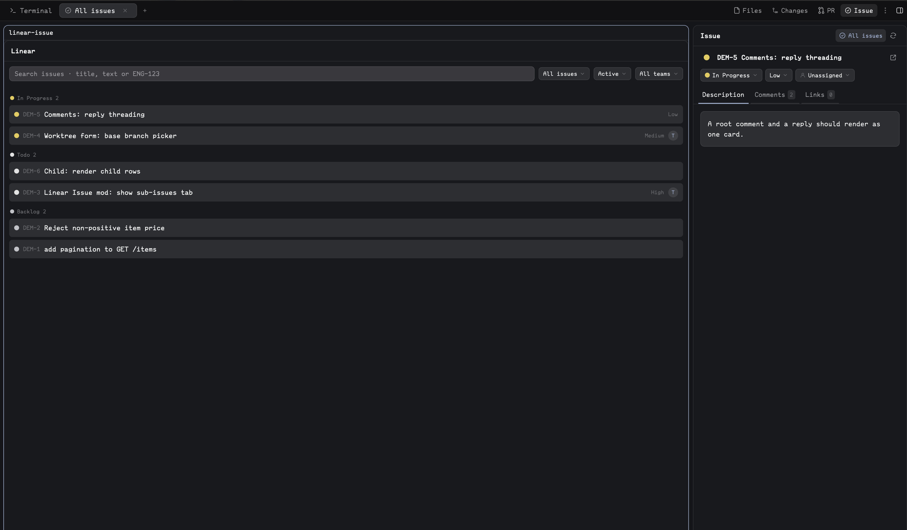

# Linear Issue

A standalone native Linear issue sidebar and issue browser for [Herdr Desktop](https://herdr.dev/), built as a sibling of [GitHub PR](../github-pr/README.md).



- **Branch sidebar:** the issue linked to the current checkout, found from a `branch.<name>.herdr-issue` binding or the identifier in the branch name (`me/eng-123-fix-login` → `ENG-123`). Several identifiers on one branch give a picker.
- **All issues:** one reusable browser tab per space with search, **My issues / Active cycle / All** scopes, state and team filters, grouped by workflow state.
- Issue details: description, threaded comments, links, sub-issues, and quick edits for **state, priority and assignee**.
- **Start work:** a worktree from the issue using Linear's own branch name, opened as a nested space with a terminal or an installed agent that receives the issue as its first prompt.
- Explicit comment/reply/edit controls and agent handoff prompts. Nothing is written to Linear without a click.
- No dependency on Factory, Better Tabs, Workflow, GitHub PR, or another custom mod.

## Install

> Read ~/.config/herdr-app/AGENTS.md, then add this mod: https://github.com/munza/herdr-mods/tree/main/linear-issue

Requirements: Herdr with native mod tabs, Python 3 for the installer, **Go 1.23+** to build the helper, Git on source machines, and a **Linear personal API key**. Agent actions additionally use `hc` and a live agent in the source space.

**This mod talks to Linear's GraphQL API directly** through its bundled helper, with the key from the **`LINEAR_API_KEY`** environment variable and nothing else: there is no key field, keychain entry or token file. Create a personal key at https://linear.app/settings/api and export it in your shell environment (for example in your dotfiles). The helper reads its own environment first and then asks your login shell, so a key exported in `.zshrc` or by home-manager is found even when Herdr was launched from the Dock. A missing or rejected key shows a plain message in the panel with a Retry button; nothing else works until it is fixed.

Read [RECIPE.md](RECIPE.md) and the source before installation. The helper sends your key to api.linear.app only and never stores it; the mod runs Git/`hc` on the source machine. Explicit user actions can **post comments and replies, edit your own comments, change an issue's state/priority/assignee, fetch a base branch and create Git worktrees/branches, write issue-association config, open spaces, and send agent prompts**. Never test mutations against a user's workspace without their instruction.

From this package directory:

```sh
python3 install.py
# Later, update an existing installation owned by this package:
python3 install.py --update
```

The installer builds the local helper without third-party Go dependencies, copies **only** `mods/linear-issue/` and the helper to `~/.config/herdr-app/mods/linear-issue/`, then runs `herdr-app check`. It does not edit layouts or keys. `HERDR_APP_HOME` or `--app-home` selects a different config home. It refuses an existing name unless `--update` is explicitly supplied for an existing Linear Issue manifest.

The helper is installed at `mods/linear-issue/bin/herdr-linear`. Go is needed only to build it, not at runtime.

### Place the sidebar

Herdr's shipped layouts (`main`, `terminals`, `win98`) are read-only and restored on every start, so the mod only shows in a layout you own. If you are on a shipped layout, your agent clones it and edits the clone; if you already have your own layout, it asks whether to add the mod there or create a new layout. Add a block to the panel stack, or replace an existing slot's content preserving its ID and dimensions:

```json
{ "mod": "linear-issue", "props": { "mode": "branch" } }
```

The manifest has `place: none`, so copying alone does not dock a sidebar. The **All issues** button opens/selects a browser tab directly; no toolbar integration is required.

### Open a browser tab

```sh
herdr-app do tab.new '{"name":"All issues","mod":"linear-issue","props":{"mode":"browser"}}'
```

The sidebar's **All issues** action supplies `{mode:"browser",space,source:{cwd,on}}`, pinning the checkout and machine captured when opened. Repeated opens reuse the current space's existing tab.

### Optional Better Tabs integration

On start the mod publishes its icon under the shared `mod-icons` map so a Better Tabs bar shows it on the All issues tab. A toolbar panel action points at the **layout node ID** holding the sidebar block:

```json
{
  "id": "issues",
  "label": "Issue",
  "icon": "mods/linear-issue/issue.svg",
  "action": { "type": "panel", "container": "panel", "stack": "panel-body", "target": "linear-issues" }
}
```

## Branch discovery

The sidebar reads the symbolic branch of the active terminal's checkout. It unions the identifiers in `git config branch.<branch>.herdr-issue` (comma separated) with any `TEAM-123` patterns in the branch name, confirms each with Linear, and drops the ones that do not exist. Branches such as `main` or `release-2024` never resolve. When nothing matches, the panel offers a **Link issue** field that confirms the identifier with Linear and writes the binding. With several issues, a picker in the header chooses which one the sidebar shows and remembers the choice per space. An issue you linked by hand shows an **Unlink** icon next to the title that removes it from the binding again; an identifier that is part of the branch name has no such control, since it would simply be found again.

## Browse, read, and edit

Search debounces for 450ms and starts at three characters; Linear matches titles and descriptions, and a query shaped like `ENG-123` also matches that identifier. **My issues** filters by assignee, **Active cycle** by the team's running cycle, **All issues** by nothing. The state filter maps to workflow state types: Active (triage, backlog, unstarted, started), Backlog, Started, Done, Cancelled, All. A **Team** picker appears when the workspace has more than one team. The list groups rows by workflow state with the state's own colour, and **Load more** continues Linear's cursor.

Details show the identifier and title, an **Open in Linear** icon, and a meta row with three pickers that write immediately on choice: **state** (the team's workflow states), **priority**, and **assignee** (Me, Unassigned, then team members). Labels, project, cycle and estimate follow. Tabs: **Description** (Markdown, with the parent issue), **Comments** (threads by parent comment, **Edit** on your own comments, **Reply** per thread, **Add comment**), **Links** (Linear attachments, including pull-request links), and **Sub-issues** when there are any.

Comments open an editor with Markdown preview; nothing posts before an explicit Reply/Comment/Save. Drafts survive errors and navigation. On a timeout, refresh before retrying since the write may have succeeded.

## Start work and agents

**Start work** in the browser detail opens a compact form: Branch (prefilled with Linear's `branchName` for the issue, with a numeric suffix when that branch already has a worktree), Worktree (follows the branch until edited), From (the base branch, defaulting to the remote's HEAD), **Open with** (Terminal or any installed agent), and an optional **Move to Started** toggle. Creation fetches the base from `origin`, refuses existing branches and bad names, creates `~/.herdr/worktrees/<repo folder>/<worktree-name>` on the source machine, binds the branch to the issue, and opens the checkout as a **new space**. With an agent chosen, the agent starts with the issue (title, URL, description, latest comments) as its first prompt. Existing worktrees for the issue are listed above the button; clicking one switches to its space or opens one.

**Hand to agent** and **Send to agent** offer agents in the source space and an editable prompt containing the issue and, for a thread, its comments. Only Send delivers through `hc`. The prompt labels the Linear text as data, not instructions.

## Commands

Commands reach shown mod copies:

- `linear-issue.open-browser` (alias `toggle`): open/select the reusable browser tab.
- `linear-issue.refresh`, `linear-issue.back`, `linear-issue.open:ENG-123` (browser), `linear-issue.description`, `linear-issue.comments`, `linear-issue.links`, `linear-issue.worktree`.

## Development

```sh
node --test tests/*.test.cjs
python3 -m unittest discover -s tests
(cd helper && go test ./... && go vet ./...)
herdr-app check "$HOME/.config/herdr-app/mods/linear-issue"
```

`main.js` owns native UI, branch and browser state, commands, and async invalidation. `typography.js` is shared with GitHub PR byte for byte. `helper/main.go` is the JSON bridge to Linear's GraphQL API with validated requests, key storage, and a 26-second timeout. Tests use mocked API calls, not live Linear writes.

See [LICENSE](../LICENSE) and [NOTICE](../NOTICE) for attribution.
